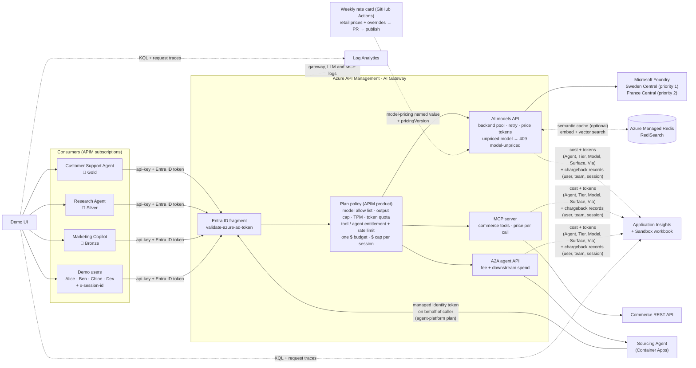
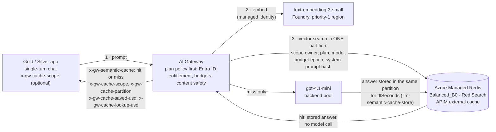

# APIM ❤️ Microsoft Foundry

## [AI Gateway Sandbox lab](ai-gateway-sandbox.ipynb)

[](ai-gateway-sandbox.ipynb)

A hands-on sandbox for Azure API Management as **one AI Gateway for the three AI surfaces**: **AI models** (Microsoft Foundry `gpt-4.1`, `gpt-4.1-mini`, `gpt-4.1-nano` and `DeepSeek-V3.2`), **MCP servers** (a REST API exposed as MCP tools) and **A2A agents** (a Sourcing Agent on Azure Container Apps). It covers **identity, plans, routing, metering and evidence** for all three in one place, with cost and tokens as one theme among them:

- **One plan, one contract.** Each APIM **product** (Gold, Silver, Bronze) is a commercial plan. It bundles which models, MCP tools and A2A agents a consumer may use, their limits, and **one $ budget**.
- **Every call is priced.** Model calls by tokens, MCP tool calls per call, A2A tasks by a fee plus everything the agent spends downstream.
- **Pricing beyond tokens.** Responses API calls pay the cheaper cached rate for input tokens served from the prompt cache. Reading a stored response is free, and follow-up calls stay on the region that stored the response. Optional image generation is priced per image by model, quality and size. All of it draws on the same plan and $ budget (see [Pricing beyond tokens](#pricing-beyond-tokens-responses-api-and-images)).
- **Answer once, serve many.** An optional semantic cache on **Azure Managed Redis** answers a question that was already asked in other words without calling the model. A hit is charged only its embedding lookup. By default an answer is only reused in its own session; an app can opt in to sharing per user or per plan, and answers never cross plans (see [Semantic cache](#semantic-cache-answer-once-serve-many-azure-managed-redis)).
- **Spend follows the payer.** When an A2A agent calls models and tools for a caller, the gateway charges that spend back to the caller's budget and records the agent as `Via`.
- **One chargeback view.** Cost by consumer, plan, surface (model, tool, agent) and resource in Application Insights and an Azure Monitor workbook.
- **Chargeback by user and session.** Demo users (one subscription key each, no Entra ID accounts needed) work in sessions. A $ cap per session stops a runaway conversation or agent loop, and every priced call is recorded by user, team, cost center and session (see [FinOps chargeback by user and session](#finops-chargeback-by-user-and-session)).
- **Zero trust and resilience, with evidence.** Every call needs a Microsoft Entra ID token as well as the key. Model calls are load balanced across two Foundry regions with a circuit breaker, and every policy decision can be traced and found in the Azure Monitor logs (see [Policies in action](#policies-in-action-entra-id-load-balancing-and-what-the-logs-track)).



### What each plan includes

Each **consumer** has its own APIM subscription, which gives it an identity and a key. Each consumer belongs to a **plan** (an APIM product). The [plan policy](product-policy.xml) applies the plan to every surface:

| Control | Surface | Policy | Result when exceeded |
|---|---|---|---|
| 🧭 **Model governance**: which models a plan can use | models | `choose` + `set-body` | premium models are **downgraded** to a cheaper model, or **denied** (403) |
| ✂️ **Output cap**: maximum `max_tokens` per call | models | `set-body` | the request is capped transparently |
| ⏱️ **Tokens per minute** | models | [`llm-token-limit`](https://learn.microsoft.com/azure/api-management/llm-token-limit-policy) | 429 + `Retry-After` |
| 📦 **Token quota** per day/month | models | [`llm-token-limit`](https://learn.microsoft.com/azure/api-management/llm-token-limit-policy) | 403 |
| 🧰 **Tool entitlement + calls per minute** | MCP | `choose` + [`rate-limit-by-key`](https://learn.microsoft.com/azure/api-management/rate-limit-by-key-policy) | 403 `tool-denied` (JSON-RPC error) / 429 |
| 🤝 **Agent entitlement + tasks per minute** | A2A | `choose` + [`rate-limit-by-key`](https://learn.microsoft.com/azure/api-management/rate-limit-by-key-policy) | 403 `agent-denied` / 429 |
| 🖼️ **Image model and quality entitlement + images per minute** (optional) | images | `choose` + `rate-limit-by-key` | 403 `image-entitlement` / `image-quality` / 429 |
| 🔒 **Stored responses stay with their owner** | Responses API | APIM cache: response id → backend + subscription | 404 `response-ownership` |
| 🧠 **Semantic cache** (optional; on for `azd up`, off in the notebook; Gold and Silver when on) | models | [`llm-semantic-cache-lookup`](https://learn.microsoft.com/azure/api-management/llm-semantic-cache-lookup-policy) / [`llm-semantic-cache-store`](https://learn.microsoft.com/azure/api-management/llm-semantic-cache-store-policy) on Azure Managed Redis, partitioned per session by default (`x-gw-cache-scope: user` or `plan` to share) | a similar single-turn question is answered from the cache: no model call, only the embedding lookup is billed |
| 💵 **One $ budget** for models, tools and agents | all | [`quota-by-key`](https://learn.microsoft.com/azure/api-management/quota-by-key-policy) incremented by each call's cost | 403 |
| 🧾 **$ cap per session** | all | a second `quota-by-key` keyed on subscription + session | 403 `session-budget` |
| 🛡️ **Blocked before spend**: content safety (optional; on for `azd up`, off in the notebook; Gold, Silver, Bronze when on) | all | [`llm-content-safety`](https://learn.microsoft.com/azure/api-management/llm-content-safety-policy) with Prompt Shields and a sensitive-data blocklist, in the [blocked-before-spend fragment](content-safety-fragment.xml) | 403 `llm-content-safety`, $0 of model tokens; the check itself is billed to the $ budget |
| 🔏 **Purview DLP** (optional, off by default) | all | Microsoft Graph `processContent` in the [purview-dlp fragment](purview-dlp-fragment.xml) | 403 `purview-dlp` |
| ⛔ **Over budget, switched off** (operations loop, optional) | all | Gateway subscription-budget error → direct callback → Logic App with a managed identity ([budget-suspend.bicep](budget-suspend.bicep)) | the APIM **subscription is suspended** asynchronously: its key is rejected on every API and a `BudgetBreach` audit event is written. No periodic spend scans. See [Over budget, switched off](#over-budget-switched-off) |

| Consumer | Plan | Models | Disallowed models | TPM | Token quota | Max output | MCP tools | A2A agents | $ budget | $ per session |
|---|---|---|---|---|---|---|---|---|---|---|
| Customer Support Agent | 🥇 Gold | all four | n/a | 20,000 | 1M / month | 2,000 | all three, 60/min | Sourcing Agent, 10/min | $5.00 | $0.02 |
| Research Agent | 🥈 Silver | gpt-4.1-mini, gpt-4.1-nano, DeepSeek-V3.2 | downgraded to gpt-4.1-mini | 12,000 | 200K / month | 800 | `search-products`, `check-inventory`, 30/min | Sourcing Agent, 3/min | $0.01 | $0.01 |
| Marketing Copilot | 🥉 Bronze | gpt-4.1-nano | denied (403) | 1,500 | 20K / day | 300 | `search-products`, 10/min | none | $0.02 | $0.01 |

Image generation (optional, `images.enabled`): Gold may generate `low`, `medium` and `high` quality images, 5 per minute. Silver may generate `low` and `medium`, 2 per minute. Bronze may not generate images.

Demo price list (the `model-pricing`, `tool-pricing` and `agent-pricing` named values):

**Optional weekly model pricing (phase 1):** the [price-list lifecycle](pricing/README.md)
discovers deployed token models, resolves exact retail meters or reviewed internal
overrides/PTU allocations, and opens a weekly price-card PR with a readable diff and
version history. After review/merge, a separately approval-gated OIDC workflow updates
only `model-pricing` (including cached rates and `pricingVersion`), with coverage and
4,096-character checks. Configure the Azure identities/account allow list and provision
the updated policy files once before enabling publication. Flat tool, agent, image and
content-safety prices are unchanged; streaming responses remain a known unpriced path.
Cost Management reconciliation is **phase 2**, not implemented here.

| Resource | Surface | Price |
|---|---|---|
| `search-products` | MCP tool | $0.0005 per call |
| `check-inventory` | MCP tool | $0.0002 per call |
| `get-supplier-quote` (premium data) | MCP tool | $0.0020 per call |
| `sourcing-agent` | A2A agent | $0.0050 per task + its downstream model and tool spend |
| `content-safety` (screening) | safety check | $0.38 per 1K text records (1 record = up to 1,000 characters; Prompt Shields adds a second record per call), from `contentSafety.pricePer1KRecordsUsd` |
| Foundry models | AI model | per 1M input/output tokens, see the notebook |
| Cached input tokens (Responses API) | AI model | `gpt-4.1` $0.50, `gpt-4.1-mini` $0.10, `gpt-4.1-nano` $0.025 per 1M (`cached-input-pricing`); other models pay the full input price |
| Stored response read (`GET /responses/{id}`) | AI model | free |
| `gpt-image-1-mini` (optional) | Image | per image (`image-pricing`): `low` $0.005–0.006, `medium` $0.011–0.015, `high` $0.036–0.052, by size (1024x1024, 1024x1536, 1536x1024) |
| Semantic cache lookup (optional) | AI model | `text-embedding-3-small` at $0.02 per 1M tokens (`semanticCache.embeddingPricePer1MTokensUsd`), at least $0.000001 per lookup. A hit pays only this; a miss pays it on top of the model tokens |

### How it works

- **AI models**: the [models API policy](policy.xml) prices every call from the token usage and returns `x-gw-*` headers (served model, governance actions, tokens, cost, remaining tokens per minute).
- **Streamed model calls** (`"stream": true`) are charged at their **ceiling** (`x-gw-pricing-rule: stream-ceiling`). The usage block arrives at the end of a Server-Sent Events stream, and reading it would make the gateway buffer the whole stream. So the gateway charges the estimated prompt tokens (text length / 4, 1,200 tokens per image) plus the plan's full `max_tokens`. No cached-input discount applies. Before this ceiling charge, a streamed call cost $0 against the $ budget. The charge errs high, so send `"stream": false` when you need the exact price. The `x-gw-prompt-tokens` and `x-gw-completion-tokens` headers and the chargeback record carry the estimate. To reconcile, compare chargeback records with `pricingRule = stream-ceiling` against the actual streamed token counts in `ApiManagementGatewayLlmLog` (`IsStreamCompletion`).
- **MCP server**: APIM exposes the [commerce REST API](src/tools/openapi.json) as the `commerce-mcp` **MCP server**. Every MCP tool maps to an API operation, so the [MCP policy](src/tools/mcp-policy.xml) can price each `tools/call` and the plan policy can entitle and rate-limit each tool.
- **A2A agents**: APIM fronts the [Sourcing Agent](src/agent/agent.py) as an **A2A agent API**. Both the agent card and `message/send` tasks need a subscription key, so discovery is governed too, and tasks need a plan that includes the agent. The agent runs on Container Apps and only accepts calls that carry a gateway secret, so it can't be called around the gateway.
- **Chargeback**: the Sourcing Agent calls models and tools through APIM with its own `agent-platform` subscription and sends `x-gw-on-behalf-of: <caller>`. The [attribution fragment](attribution-fragment.xml) trusts that header only from the `agent-platform` plan, so the spend is drawn from the **caller's** $ budget and tagged `Via = sourcing-agent`. The [A2A policy](src/agent/a2a-policy.xml) adds the agent fee and returns the full bill (`x-gw-agent-fee-usd`, `x-gw-downstream-cost-usd`, `x-gw-cost-usd`, `x-gw-billed-to`).
- **Metrics**: every surface emits `CostMicroUSD` (plus `Prompt Tokens`, `Completion Tokens`, `Total Tokens` for models, and `GovernanceEvents`) to Application Insights with the `Agent`, `Tier`, `Model` (the model, tool or agent), `Surface` and `Via` dimensions.

> [!NOTE]
> The prices are **demo prices**. Check the [Azure OpenAI](https://azure.microsoft.com/pricing/details/cognitive-services/openai-service/) and Foundry Models pricing for current prices in your region. The Silver and Bronze budgets are deliberately tiny so you can exhaust them live: one Sourcing Agent task (about $0.009) nearly uses up Silver's $0.01. Every counter key includes the `budget-epoch` named value, so changing it resets all budgets and quotas: use the notebook reset step or the UI **Reset budgets** button before each demo. The UI's reset waits until Azure reports the new named value as provisioned (up to 90 s), so the scenarios that reset first don't race the old counters.

In the Azure portal, open the APIM instance to see the gateway's own views of the three surfaces: **APIs → AI models**, **APIs → MCP servers** and **APIs → A2A agents** (preview), and **Products** for the plans.

### Blocked before spend: content safety and Purview DLP

A guardrail that runs *after* the model has answered has already spent the tokens. The [blocked-before-spend fragment](content-safety-fragment.xml) runs **last in the plan policy's inbound**, after identity, entitlements, limits and the $ budget check, and before any backend is called:

- **What is screened.** The text the caller sends, on every surface listed in `contentSafety.surfaces`: model `messages` / `input`, the MCP `tools/call` **arguments**, and the A2A `message/send` **task text**. A blocked tool call never reaches the MCP server, and a blocked task never reaches the Sourcing Agent or spends anything downstream.
- **How.** [`llm-content-safety`](https://learn.microsoft.com/azure/api-management/llm-content-safety-policy) calls an [Azure AI Content Safety](https://learn.microsoft.com/azure/ai-services/content-safety/overview) account ([content-safety.bicep](content-safety.bicep), managed identity, local auth disabled) with **Prompt Shields** (jailbreaks), the four harm categories (threshold `contentSafety.thresholds`, eight severity levels) and a **sensitive-data blocklist** (`contentSafety.blocklist`: US SSN and card number regexes). Edit those in [sandbox-config.json](sandbox-config.json) (or the notebook's first cell).
- **Which plans.** `"contentSafety": true` on a plan in `sandbox-config.json`. Gold, Silver and Bronze have it; the internal `agent-platform` plan doesn't, because the Sourcing Agent's downstream calls carry a task that was already screened when it came in.
- **What the caller sees.** **403** with `x-gw-blocked-by: llm-content-safety`, `x-gw-governance: content-blocked`, `x-gw-prompt-tokens: 0`, `x-gw-cost-usd: 0` and `x-gw-safety-cost-usd`. Every screened call, passed or blocked, returns `x-gw-safety-cost-usd`.
- **Tokenomics.** Blocked calls spend **$0 of model tokens**. The screening itself is not free: the [safety-ledger fragment](content-safety-ledger-fragment.xml) prices each check from the text length (records × `pricePer1KRecordsUsd`), draws it from the plan's $ budget, and writes it as its own line item: a chargeback record with `surface = safety`, `item = content-safety`, `blocked`, `checkedSurface` and `checkedItem`, plus a `CostMicroUSD` metric with `Surface = safety`. A block also emits `GovernanceEvents` with `Event = content-blocked`. A short call costs 2 records, about **$0.00076**.
- **Evidence.** `ApiManagementGatewayLogs` rows with `LastErrorReason == "ContentSafetyPolicyViolated"` and no backend call (Prompt Shields and harm blocks log `LastErrorSource = llm-content-safety`, blocklist matches `request-forwarder`; the `x-gw-blocked-by` header is `llm-content-safety` for both), the `content-blocked` events, and the `safety` chargeback records. The workbook's **Budgets & governance** and **Gateway evidence** tabs show them, and so do the UI's **Safety checks** ledger column and **Proof: logs & monitoring** tab.

**It is on for `azd up` and off by default in the notebook.** It's controlled by `"contentSafety": {"enabled": true}` in [sandbox-config.json](sandbox-config.json) (or `content_safety_config["enabled"] = True` in the notebook's first cell); after changing it, redeploy (`azd up` or the notebook's deployment step). The plans already opt in (`"contentSafety": true` on Gold, Silver and Bronze), so the lab-level flag is all it takes. It deploys one Content Safety account (S0, pay per use). Every screened call then costs about **$0.0008 more**, and that comes out of the plan's $ budget. Silver's budget is deliberately tiny ($0.01), so with content safety on, scenarios 5 and 8 reach Silver's 403 a call or two sooner. When it's off, the fragments are deployed as no-ops, no Content Safety account is created, scenario 15 only says how to turn it on, and scenarios 1–14 behave exactly as before.

> [!NOTE]
> The [Content Safety price](https://azure.microsoft.com/pricing/details/cognitive-services/content-safety/) is a list price for the standard tier at the time of writing [verify for your region and agreement]. Content Safety blocklists can take a few minutes to take effect after a deployment. If the sensitive-data calls pass right after `azd up`, run the scenario again.

#### Purview DLP (optional, off by default)

The [purview-dlp fragment](purview-dlp-fragment.xml) and [purview-dlp.bicep](purview-dlp.bicep) follow the [Purview DLP lab](../apim-purview-dlp/README.md): the gateway exchanges the caller's **user** token (sent as `x-user-assertion`) on behalf of the user and calls Microsoft Graph [`processContent`](https://learn.microsoft.com/graph/api/userprotectionscopecontainer-processcontent). If a Purview DLP policy for custom AI apps says *block*, the call returns **403** `x-gw-blocked-by: purview-dlp` and emits a `dlp-blocked` governance event. An unreadable verdict also blocks (fail closed). Calls without `x-user-assertion` are not evaluated (`x-gw-purview: skipped-no-user`), or get 403 when `purviewDlp.requireUser` is true. A Purview block returns directly from inbound, so its content safety check is not written to the safety ledger. It is **off by default** (`purviewDlp.enabled: false`) because it needs things a demo tenant usually doesn't have:

- real **Entra ID users** (not the subscription-key demo users), each with a Microsoft 365 E5 or E5 Compliance license, sending a delegated user token
- an app registration with the Graph delegated permissions `Content.Process.User`, `ProtectionScopes.Compute.User` and `ContentActivity.Write`, admin consent, and a **client secret** (`PURVIEW_CLIENT_SECRET` for `azd`, or the environment variable of the same name for the notebook)
- a Purview DLP policy scoped to custom AI apps, Purview pay-as-you-go billing and Audit turned on, and up to about an hour of policy propagation

Content safety's sensitive-data blocklist covers the demo story without any of that. Turn Purview on with `purviewDlp.enabled: true` and `purviewDlp.clientId` once the tenant is ready. Only the Bicep build is validated for this path.

In the Azure portal, the content safety account and its blocklist are under **Azure AI services → Content Safety**, and the two fragments are under **APIM → Policy fragments**.

### FinOps chargeback by user and session

The plans answer *how much can this subscription spend*. FinOps also needs *who* spent it and *on what piece of work*, so it can be charged back to a team and cost center.

| Demo user | Subscription | Plan | Team | Cost center |
|---|---|---|---|---|
| Alice Chen | `user-alice` | 🥇 Gold | Customer Care | CC-1001 |
| Ben Okafor | `user-ben` | 🥈 Silver | Customer Care | CC-1001 |
| Chloe Martin | `user-chloe` | 🥉 Bronze | Marketing | CC-3003 |
| Dev Patel | `user-dev` | 🥇 Gold | Supply Chain | CC-2002 |

- **Users are subscription keys.** Each demo user has their own APIM subscription on a plan, so the demo needs no Entra ID accounts. The `chargeback-directory` named value maps every subscription (users and agents) to its display name, team and cost center.
- **Sessions come from the request.** The [plan policy](product-policy.xml) takes the session from `x-session-id`, then the MCP `Mcp-Session-Id`, then the A2A `contextId`. Values must match `^[A-Za-z0-9._:-]{1,128}$`, otherwise the call counts as `no-session`. The session is returned in `x-gw-session`. When the Sourcing Agent works for a user, it forwards the session (`x-gw-on-behalf-of-session`, trusted only from the `agent-platform` plan), so the agent's model and tool calls land in the **same user and session**.
- **A $ cap per session.** A second `quota-by-key`, keyed on subscription + session, stops one runaway conversation or agent loop (`403`, `x-gw-blocked-by: quota-by-key (session-budget)`) without touching the user's plan budget. A new session starts fresh. The cap is a soft limit: quota counters are updated asynchronously after each successful call, so a fast loop can run a few calls past it (in testing, $0.024–$0.029 against a $0.02 cap). Use it to contain runaway loops, not as an exact invoice limit.
- **Chargeback records.** The [`chargeback-record` fragment](chargeback-fragment.xml), included by the models, MCP and A2A policies, writes one `trace` per priced call to Application Insights (`traces`, or `AppTraces` in Log Analytics) with `record = chargeback` and the user, display name, team, cost center, kind (user or agent), session, surface, item, tokens, plan, `via`, Entra ID caller and request id.
- **No double counting.** Sum `costMicroUsd`. An A2A record carries only the agent fee; the agent's model and tool calls are separate records (`via = sourcing-agent`) for the same user and session. So a session total is the **fully loaded cost** of that piece of work. `chargedMicroUsd` is what the call drew from the budgets (for an A2A task, the fee plus the downstream spend).
- **Why traces, not metric dimensions?** `emit-metric` allows at most 5 custom dimensions, and user and session are high-cardinality. The cost metrics keep the 5 low-cardinality dimensions (Agent, Tier, Model, Surface, Via); the records carry everything else.

```kusto
traces
| where tostring(customDimensions["record"]) == "chargeback"
| extend Team = tostring(customDimensions["team"]), User = tostring(customDimensions["displayName"]),
         Session = tostring(customDimensions["session"]), Cost = tolong(customDimensions["costMicroUsd"])
| summarize CostUSD = round(sum(Cost) / 1e6, 6), Calls = count() by Team, User, Session
| order by CostUSD desc
```

> [!TIP]
> In production, take the user from the Entra ID token (the `oid` or `preferred_username` claim that `validate-azure-ad-token` already validates) and the team and cost center from a directory attribute, instead of one subscription key per user. The session cap, the records and the queries stay the same.

### Per-user $ budgets inside one app

One subscription key per user doesn't scale when an app serves thousands of people. Instead, the app keeps **one key on one product** and names the person it is acting for in the `x-gw-end-user` header. The [plan policy](product-policy.xml) gives each end user their own $ counter inside that key:

- **Budgets come from config, not policy.** The `end-user-budgets` named value (rendered from `endUserBudgets` in [sandbox-config.json](sandbox-config.json)) holds budget classes, a default class for anyone not listed, and per-user overrides: `default=standard;standard=5000;power=15000;exec=50000;@raj.iyer=power;@tom.intern=2000` (amounts in micro-USD). Changing a budget is a named value update, with no policy redeploy.
- **One policy for any amount.** `quota-by-key` only accepts a literal `calls` limit, so the counter is keyed on subscription + user + budget epoch with `calls="1000000"`, and each call adds its cost in **millionths of that user's own budget** (`ceil(cost × 10⁶ / budget)`). A $0.005 user and a $50 user share the same policy.
- **Budgets nest.** End user < app (plan $ budget) < per-session cap. A call must fit every level; the app's own calls (no header) only draw on the plan budget. Blocked calls return 403 with `x-gw-blocked-by: quota-by-key (end-user-budget)`; every response carries `x-gw-end-user` (user and class) and `x-gw-end-user-budget-usd`, and chargeback records carry `endUser`.
- **Validation.** Values must match `^[a-z0-9._@-]{1,64}$` (lower-cased, so `Raj.Iyer` and `raj.iyer` share one budget); anything else gets 400 `end-user-header`. The header is removed before the call reaches Foundry, MCP or the agent. **Reset budgets** resets end-user budgets too.

Limits: the header is asserted by the app, so it is only as trusted as the app key. In production, take the user from the validated Entra ID token (`oid`) instead, the class from an app role or group, and overrides from a budget service via `send-request` + `cache-lookup-value` (a named value tops out around 4,096 characters). Calls the Sourcing Agent makes on a user's behalf are charged to the A2A task, not to the end user's counter. Like every quota here, the cap is soft and counters are per region.

### How a call picks its budgets (and the Entra ID path)

> [!IMPORTANT]
> **A demo shortcut, not a limit of the pattern.** The sandbox picks every budget bucket from the **subscription key and two request headers**, so it deploys with no Entra ID user accounts, app roles or groups to create. Every call already carries a Microsoft Entra ID token that the [entra-identity fragment](entra-identity-fragment.xml) validates (`output-token-variable-name="entraToken"`), so moving the buckets onto Entra ID identities only changes the **counter keys**. The budgets, the nesting, the 403s, the chargeback records and the workbook stay the same.

| Bucket | In this demo it comes from | With Entra ID in production |
|---|---|---|
| **Plan** (Gold, Silver, Bronze): limits and the plan $ budget | the APIM product of the subscription key | still the subscription key, one per calling **app**, or the token's app (`azp` / `appid`) or an app role mapped to a plan |
| **Subscription key** $ budget | one key per demo user or agent | one key per app; people move to the end-user bucket below |
| **Session** cap | `x-session-id` (or `Mcp-Session-Id`, A2A `contextId`) | unchanged: a session is the app's unit of work, not an identity. Scope it under the user if needed |
| **End user** $ budget | `x-gw-end-user`, asserted by the app (trusted only as far as its key) | the token's `oid` (or `preferred_username`), validated by the gateway, so it can't be spoofed |
| **End-user class** (`standard`, `power`, `exec`) | `@user=class` entries in the `end-user-budgets` named value | an Entra ID app role or group claim (`roles` / `groups`); keep the named value for the amounts per class |
| **Chargeback** user, team, cost center | the `chargeback-directory` named value, keyed by subscription | the token's user plus directory attributes (department, cost center) |

For the end-user bucket, the change in the [plan policy](product-policy.xml) is the source of `endUser`. Everything after it, including validation, the class lookup and the `quota-by-key` counter, already works on that variable:

```xml
<!-- demo: the app names its end user in a header -->
<set-variable name="endUser" value="@(context.Request.Headers.GetValueOrDefault("x-gw-end-user", "").Trim().ToLowerInvariant())" />

<!-- production: the gateway takes the user from the validated Entra ID token (a user token; app-only tokens have no end user) -->
<set-variable name="endUser" value="@{
    var jwt = (Jwt)context.Variables["entraToken"];
    return jwt.Claims.GetValueOrDefault("idtyp", "user") == "app" ? "" : jwt.Claims.GetValueOrDefault("oid", "").ToLowerInvariant();
}" />
```

What the production version needs that the demo avoids: the calling app must send **user (delegated) tokens**, the app roles or groups must exist and be assigned, and `oid` is a GUID, so map it to a display name in the chargeback directory or the workbook. The UI's live budget meter shows the same note (**🔑 Demo picks buckets by key + headers · Entra ID-ready**).

### Entra-only mode: plans and budgets from security groups (optional)

The keyed path above stays the default. **Entra-only mode** deploys a second, key-less copy of the models API next to it, so you can show both side by side with the **Keys + Entra | Entra only** toggle at the top of the demo UI. It is on for `azd up` (`entraMode.enabled` in [sandbox-config.json](sandbox-config.json); set it to `false` to skip it, for example in a tenant where you can't create app registrations or security groups). The notebook doesn't deploy it.

| | Keys + Entra (default) | Entra only |
|---|---|---|
| API | `inference/openai/v1` | `entra/inference/openai/v1` (`subscriptionRequired: false`, chat completions only) |
| Which plan applies | the APIM product of the subscription key | the caller's **security group**, mapped to a plan by the `entra-gateway-groups` named value |
| $ budgets | plan budget per key, session cap, optional end-user budget | **team budget** per group (one counter shared by every member) + **member cap** per caller `oid` |
| Token | audience `https://cognitiveservices.azure.com`, approved client apps | audience = the **gateway app registration**, app role `Gateway.Invoke` required |
| Policies | [product-policy.xml](product-policy.xml) at `<base />` | [entra-plan-inbound-fragment.xml](entra-plan-inbound-fragment.xml) + [entra-plan-tier.xml](entra-plan-tier.xml) per tier + [entra-plan-outbound-fragment.xml](entra-plan-outbound-fragment.xml), rendered into the same [policy.xml](policy.xml) at `{plan-inbound}` / `{plan-outbound}` / `{plan-on-error}` |

[entra-mode.bicep](entra-mode.bicep) creates, with the Microsoft Graph Bicep extension: the gateway app registration (`groupMembershipClaims: SecurityGroup`, v2 tokens, app role `Gateway.Invoke`), one security group per entry of `entraMode.groups` (tier, `budgetUsd` for the team, `memberBudgetUsd` per member), and one user-assigned managed identity per entry of `entraMode.identities` ([entra-personas.bicep](entra-personas.bicep)), added to its group and assigned `Gateway.Invoke` **directly** (Entra ID doesn't put app roles inherited through a group into a service principal's token). The personas are attached to the hosted UI, which requests their tokens from the managed identity endpoint. `entra-contractor` has the app role but no group, so the gateway answers 403 `entra-group`.

How the gateway decides: `validate-azure-ad-token` (audience + `roles`) → the token's `groups` claim is matched against `entra-gateway-groups` (`<group object id>=<name>|<tier>|<rank>|<pool micro-USD>|<member micro-USD>;...`; a caller in several groups gets the best plan) → the tier's model governance, output cap and per-member `llm-token-limit` → `quota-by-key id="group-budget"` and `id="member-budget"`, both counted in millionths of their own budget so the amounts change with a named value update. Pricing, metrics, chargeback (billed to the persona, team = the group) and failover are the unchanged [policy.xml](policy.xml): `payer-attribution` prefers the `entraPayer` / `entraTier` variables when the Entra-only fragment set them. **Reset budgets** resets these counters too (same `budget-epoch`).

**How the UI shows it.** Under the **Entra only** toggle, the budget view above the chat composer switches from key → session → end-user buckets to **team budget → member caps**. It shows the caller's group (and so their plan), the team bar shared by every member, each member's cap with the caller highlighted, and which of the two runs out first. It also says how much the caller can still spend: the smaller of the two amounts left. When member caps add up to more than the team budget (Customer Care: 2 × $0.02 against $0.03), the view says so, because the team then runs out before any one member reaches their cap. The **Budgets** panel lists the same groups under **Entra only**. Spend comes from the chargeback records of each persona (`/api/budgets`), and a group's spend is the sum of its members' records.

**Validated on Azure (Sweden Central gateway, October 2026):** calling as the personas from the hosted UI, `entra-ana` (Customer Care, Gold) got 200 for `gpt-4.1` and `gpt-4.1-mini`, billed to `entra-ana`. The same call with no token, and with the Foundry-audience token, got 401 `validate-azure-ad-token`. `entra-contractor` got 403 `entra-group`. `entra-sam` (Supply Chain, Silver) asked for `gpt-4.1` and was served `gpt-4.1-mini`, and `entra-mia` (Marketing, Bronze) got 403 `model-entitlement`. The first live run also exposed a bug that is fixed here: the operation check read `context.Request.Url.Path`, which on this API (no service URL) is `chat/completions` without a leading slash, so every valid call got 404 `entra-mode-operation`. It now reads `context.Request.OriginalUrl`. Scenario 22 then showed two timing effects, both handled now. First, after **Reset budgets** ARM reports the new `budget-epoch` at once, but the `entra-plan-inbound` fragment kept the old one for several seconds (one run started 5 s after a reset and every call hit the old, spent team counter). The scenario now polls `/api/entra-epoch`, a free GET the key-less API refuses with 404 after setting its epoch, until its `x-gw-budget-epoch` header matches (4-10 s in testing). Second, back-to-back calls about 3 s apart overshot the caps by up to 5 calls, because API Management syncs `quota-by-key` counters asynchronously. Paced 4 s apart, the run matched the counter math exactly: Ana was stopped on her 10th call ($0.0222 against $0.02) and Raj on his 5th, when the team had spent $0.0321 against $0.03.

Requirements and limits:

- The deployer needs permission to create app registrations and security groups (many tenants restrict group creation). Some tenants require `serviceManagementReference` on app registrations.
- `includeDeployerIn` adds you (the azd `principalId`) to a group and pre-authorizes the Azure CLI, for a locally run UI. Tokens of users in more than 200 groups carry no `groups` claim, and the gateway answers 403 `entra-group-overage`; use the managed identity personas instead.
- Managed identity tokens are cached for up to 24 hours, so a group change takes effect when the token is refreshed, not immediately.
- v1 covers chat completions only; MCP tools, A2A agents, images, the Responses API, content safety and budget suspension stay on the keyed path.

### Pricing beyond tokens: Responses API and images

The same plan and $ budget also cover the **Responses API** and **image generation**:

| Surface | Priced by | Named value | Plan controls | Response headers |
|---|---|---|---|---|
| Responses API (`POST /responses`, also with `previous_response_id`) | tokens. Input tokens served from the prompt cache use the model's cached rate | `model-pricing` + `cached-input-pricing` | same as chat completions: models, output cap, TPM, token quota, $ budget, $ per session | `x-gw-cached-tokens`, `x-gw-cached-savings-usd`, `x-gw-pricing-rule` (`tokens` / `tokens+cached`, or `stream-ceiling` for `"stream": true`), `x-gw-affinity` |
| Stored response (`GET /responses/{id}`, input items, `DELETE`) | free (`stored-read`) | | only the subscription that created the response can use it | `x-gw-pricing-rule: stored-read`, `x-gw-affinity` |
| Image generation (`POST /images/generations`, optional) | **per image** by model, quality and size | `image-pricing` | image models and qualities per plan, images per minute, $ budget, $ per session | `x-gw-image-count`, `x-gw-image-unit-usd`, `x-gw-image-spec`, `x-gw-remaining-images` |

- **Cached input.** When a prompt over 1,024 tokens repeats a recent prefix, Foundry serves part of it from the prompt cache and reports `usage.input_tokens_details.cached_tokens`. The [`responses-pricing` fragment](responses-pricing-fragment.xml), included by the models API policy, prices those tokens at `cached-input-pricing` instead of the full input price. The cost metric, the chargeback record (`cachedTokens`) and the $ budget all use the lower price. Prompt caching is best effort, so a cold cache reports 0 cached tokens.
- **Session affinity for stateful calls.** A stored response lives in the Foundry resource that created it, but model calls are load balanced across two regions. The [Responses operation policy](responses-policy.xml) ([responses-ops.bicep](responses-ops.bicep)) records which backend and subscription created each response id in the APIM cache (30 days). Follow-up calls, reads and deletes then go to that backend (`x-gw-affinity: sticky:foundry1`). A call that names another subscription's response id gets 404 `response-ownership`. The built-in cache is volatile: after a cache miss (`x-gw-affinity: unknown`) the backend pool routes the call, so treat affinity and ownership as best effort, not as a security boundary.
- **Images** are an optional API ([image-api.bicep](image-api.bicep), [image policy](image-policy.xml)) at `{gateway}/images/openai/v1/images/generations`. It uses the same plans, keys, Entra ID token and managed identity as the models API. The plan policy checks the image model and quality (403 `image-entitlement` / `image-quality`), the images per minute (429), and the shared $ budget and session cap. The image policy refuses a model, quality and size combination with no price (400) and more than `maxImagesPerRequest` images. It prices the images the backend actually returned, then emits `CostMicroUSD` with `Surface = image` and a chargeback record with `imageCount`.
- **Enable images.** Images are off by default, so the base demo needs no extra model quota. To turn them on, set `"enabled": true` under `images` in [sandbox-config.json](sandbox-config.json) (for `azd up`), or set `images_config["enabled"] = True` in the notebook's first cell, then deploy again. `gpt-image-1-mini` (GlobalStandard, capacity 2) is deployed in the **priority-1 region only**, because gpt-image models are not offered in France Central, and the image API routes there directly. The image prices are illustrative, so check the [Azure OpenAI pricing](https://azure.microsoft.com/pricing/details/cognitive-services/openai-service/) for your region.
- **Realtime audio (not yet).** Realtime traffic runs over a WebSocket, and APIM runs WebSocket API policies only at the handshake (`onHandshake`), not per message. Audio tokens can't be priced or limited per message at the gateway. A reduced design would apply the plan entitlement, a connection rate limit and a budget pre-check at the handshake, then price the session afterwards from `ApiManagementGatewayLlmLog` (audio vs text tokens) with KQL. This is tracked on the roadmap in the [root README](../../README.md).

**Observed in an isolated Sweden Central test:** a Responses follow-up stayed on its owning backend and used 2,944 cached input tokens, saving $0.000883 at the demo rates. A stored read was free; a different subscription received 404 `response-ownership`. A Gold low-quality 1024x1024 image returned one image and cost $0.005; Silver's high-quality request was denied. The charges appeared in Application Insights.

**Validation limits:** Bronze image denial, the live UI scenario cards, workbook rendering, and stored-read token-quota behavior were not verified in that Azure round. The combined safety, suspension and pricing configuration has local integration checks, but has not had a combined Azure deployment test. Per-image amounts are configured demo charges, not a reconciliation of Azure's infrastructure and model invoice.

### Semantic cache: answer once, serve many (Azure Managed Redis)

Many questions an app sends are the same question in other words. With the optional **semantic cache**, the gateway answers those from **Azure Managed Redis** instead of calling the model again. It is deployed by [semantic-cache.bicep](semantic-cache.bicep) when `semanticCache.enabled` is `true` in [sandbox-config.json](sandbox-config.json) (or `semantic_cache_config` in the notebook's first cell). **It is on for `azd up`** and **off by default in the notebook**. Set `"enabled": false` to skip it: Azure Managed Redis bills per hour while it is deployed.



| Component | What it does | Where |
|---|---|---|
| Azure Managed Redis (`redis-<suffix>`, `Balanced_B0`) | Stores the prompt embeddings and the answers; the **RediSearch** module does the vector search. RediSearch can only be enabled when the database is created, and needs the `EnterpriseCluster` clustering policy and `NoEviction`. Access key authentication is on, because APIM connects to an external cache with a connection string (Microsoft Entra authentication isn't supported there). `azd up` places it in `semanticCache.redisLocation` (`norwayeast`, next to Sweden Central): in October 2026 `Balanced_B0` had no capacity in Sweden Central (`CacheCapacityUnavailable`). Remove the key to use the resource group's region. | [semantic-cache.bicep](semantic-cache.bicep) |
| APIM external cache (`default`) | Points the semantic cache policies at Redis. The lab's other cache policies (Responses affinity, Purview tokens) pin `caching-type="internal"`, so they stay in the built-in cache. | [semantic-cache.bicep](semantic-cache.bicep) |
| `text-embedding-3-small` + `embeddings-backend` | Turns each prompt into a vector. Deployed in the **priority-1** Foundry resource only; the gateway calls it with its managed identity. The weekly rate card [excludes it](pricing/overrides.json), because no consumer calls it directly. | [main.bicep](main.bicep), [semantic-cache.bicep](semantic-cache.bicep) |
| Lookup and store policies | `llm-semantic-cache-lookup` (inbound, right after the plan policy) and `llm-semantic-cache-store` (first in outbound), rendered into the models API policy from [semantic-cache-lookup-policy.xml](semantic-cache-lookup-policy.xml) and [semantic-cache-store-policy.xml](semantic-cache-store-policy.xml) | [policy.xml](policy.xml) |
| `semantic-cache-pricing` fragment | Charges a hit the embedding lookup instead of the model tokens and returns the cache headers | [semantic-cache-pricing-fragment.xml](semantic-cache-pricing-fragment.xml) |

- **What is cached.** Only single-turn, non-streamed chat completions (`/chat/completions`) from the plans in `semanticCache.tiers` (Gold and Silver by default). Multi-turn conversations, streams and the Responses API always go to the model: the same last question can mean something else in another conversation. The check reads `context.Request.OriginalUrl`, because `llm-content-safety` in the plan policy rewrites `context.Request.Url` to the Content Safety endpoint before the lookup runs.
- **Order.** The lookup runs after the plan policy (Entra ID, entitlement, model downgrade, output cap, token limits, $ budgets, content safety), so a blocked or unsafe prompt never reaches the cache and never gets a cached answer. Content safety still screens and charges every prompt: the cache saves the model call, not the checks. On a hit, the gateway skips the backend and resumes right after `llm-semantic-cache-store`, so the call is still priced, metered and charged back.
- **Similarity.** `scoreThreshold` (default `0.15`) is a vector **distance**: lower is stricter. It matches close paraphrases; raise it carefully, because a looser match can return a wrong answer. System messages are ignored for the match.
- **Isolation: who may reuse an answer.** Every lookup and every store happens in exactly one partition, so an answer is only ever readable by requests that compute the same partition. The **cache scope** decides its owner part. The app picks one of `allowedScopes` per request with the `x-gw-cache-scope` header (the gateway removes it before the backend); without it, `defaultScope` (`session`) applies:

  | Scope (`x-gw-cache-scope`) | Owner part of the partition | The same question asked again from… same session | another session, same user | another user, same plan | another plan |
  |---|---|---|---|---|---|
  | `session` (default) | subscription + end user (`x-gw-end-user`) + session (`x-session-id`) | hit | miss | miss | miss |
  | `user` | subscription + end user | hit | hit | miss | miss |
  | `plan` (opt-in shared FAQ) | the plan | hit | hit | hit | miss |

  The partition also always includes the plan, the served model and the budget epoch (a downgraded call never gets a premium model's answer, and **Reset budgets** starts a cold cache). A narrower entry is never visible through a wider scope: a session-scoped answer isn't readable by a `user` or `plan` request. Users of one app key who send `x-gw-end-user` get separate `session` and `user` partitions. A call without a session id shares the `no-session` partition of its subscription and end user. Entries expire after `ttlSeconds` (600).
- **No poisoning across instructions.** The match ignores system messages (`ignore-system-messages`), so the partition includes a hash of the system and developer messages: a caller can't plant an answer, generated under its own instructions, for callers with other instructions, even in the shared `plan` scope.
- **Evidence.** Every looked-up call returns `x-gw-cache-scope` and `x-gw-cache-partition` (`<scope>:<owner>/sys:<instructions hash>`, for example `session:user-alice/a1-1014-pq9r/sys:none`). The `SemanticCacheLookups` metric is split by `Result` and `Scope`.
- **Pricing.** A hit is charged only the estimated embedding lookup (prompt characters ÷ 4 × `embeddingPricePer1MTokensUsd`, at least $0.000001); the model price it would have cost is reported as the saving. A miss pays the model plus the lookup. The $ budgets, the chargeback record (`pricingRule = semantic-cache-hit`, 0 tokens) and the `CostMicroUSD` metric use that price. Two more custom metrics: `SemanticCacheLookups` (`Result` = `hit` or `miss`, `Scope`) and `SemanticCacheSavedMicroUSD`.
- **Headers.** `x-gw-semantic-cache` (`hit` / `miss`, or `bypass` when the request wasn't eligible: multi-turn, stream, Responses API or a plan without the cache), `x-gw-cache-scope`, `x-gw-cache-partition`, `x-gw-cache-lookup-usd`, and on a hit `x-gw-cache-saved-usd`, `x-gw-cache-saved-tokens` and `x-gw-pricing-rule: semantic-cache-hit`. A hit has no `x-gw-route`: no backend was called. `x-gw-cache-scope: off` skips the cache for one request (`x-gw-semantic-cache: bypass`): the guided scenarios send it unless they demonstrate the cache, so their repeated prompts reach the model and its token limits, $ budgets and failover, and the request builder offers it as **off (skip the cache)**. In the demo UI, pick the scope in the request builder (**⚙ Advanced › Cache scope**); a hit's **Details** in the conversation shows it side by side with the miss that stored the answer.
- **Not the prompt cache.** Foundry's prompt cache (scenario 17) discounts repeated *input tokens* and still runs the model. The semantic cache skips the model and reuses a whole answer.

**Validated on Azure (Sweden Central gateway, Redis in Norway East, October 2026):** scenario 20 matched 10 of 10 expected results. A reworded question hit in its own session (0 model tokens, 1.2 s instead of 2.8 s, $0.000247 saved, identical answer). The same question asked from another session, another user, a `user`-scoped request reading session entries, and Silver reading Gold's `plan` cache all missed. The first live run also exposed two issues that are fixed here: `llm-content-safety` rewrites `context.Request.Url` (so the cache check now reads `OriginalUrl`), and the earlier paraphrase (*"My order arrived damaged. How do I return it?"*, about 0.14 from the question with `text-embedding-3-small`) was too close to the 0.15 threshold and missed. The scenario now uses *"How do I send back an item that arrived damaged?"* (about 0.05).

### Policies in action: Entra ID, load balancing and what the logs track

The plan policies above decide *what a consumer may spend*. These policies decide *who may call* and *how the call is served*:

| Policy | Where | What it does | Evidence |
|---|---|---|---|
| 🔐 [`validate-azure-ad-token`](https://learn.microsoft.com/azure/api-management/validate-azure-ad-token-policy) | [entra-identity fragment](entra-identity-fragment.xml), included first by every plan | Every model, MCP and A2A call needs a Microsoft Entra ID token for `https://cognitiveservices.azure.com` from an approved client app (Azure CLI and the Sourcing Agent's managed identity), **on top of** the key. The key says *who pays*, the token says *who calls*. No token returns **401** before any tokens are spent. The token is removed before forwarding. | `x-gw-blocked-by: validate-azure-ad-token`, `x-gw-caller`. `ApiManagementGatewayLogs.LastErrorSource`. `caller` field of the chargeback records. |
| 🪪 Managed identity end to end | Sourcing Agent → gateway → Foundry | The agent calls the gateway with its **user-assigned managed identity** token. The gateway calls Foundry with **its own** managed identity (`authentication-managed-identity`). There are no Foundry keys anywhere. | Trace: `authentication-managed-identity`. Caller `sourcing-agent (managed identity)`. |
| ⚖️ [Backend pool](https://learn.microsoft.com/azure/api-management/backends#load-balanced-pool) + [circuit breaker](https://learn.microsoft.com/azure/api-management/backends#circuit-breaker) | `inference-backend-pool`: `foundry1` (Sweden Central, priority 1) and `foundry2` (France Central, priority 2) | Priority routing with failover. A 429 from a region trips that backend's breaker for 1 minute (honouring `Retry-After`), so the next calls go straight to the other region. | `x-gw-route` (for example `foundry1 (Sweden Central) 429 > foundry2 (France Central) 200`), `x-gw-backend`. `BackendAttempts` metric. Gateway log `BackendUrl`. |
| 🔁 [`retry`](https://learn.microsoft.com/azure/api-management/retry-policy) | [models API policy](policy.xml), `<backend>` | Retries a 429/5xx call (up to twice) on the next available pool member, so the caller sees 200 instead of the regional throttle. | Trace: `retry`, `backend-pool` (`backend:foundry1 is inactive`). |
| 🧾 [`trace`](https://learn.microsoft.com/azure/api-management/trace-policy) + request tracing | all APIs | Writes the policy decisions (caller, failover) to the request trace, App Insights `traces` and gateway log `TraceRecords`. | The **Trace policies** toggle in the UI. |

> [!NOTE]
> To make failover easy to show, the lab deploys `gpt-4.1-nano` in Sweden Central with **capacity 1** (about 1K tokens per minute), so a short burst hits a real regional 429. While that backend's breaker is open, *every* model call is served from France Central for about a minute.

#### What each log tracks

| Where | Table / signal | What it tracks | Join key |
|---|---|---|---|
| Log Analytics | `ApiManagementGatewayLogs` | Every request: API, operation, product (plan), subscription, backend URL, status and backend status codes, timings, region, client IP, and **the policy that failed** (`LastErrorSource`, `LastErrorReason`, `LastErrorMessage`) | `CorrelationId` = `x-gw-request-id` |
| Log Analytics | `ApiManagementGatewayLlmLog` | Every AI model call: deployment, model, prompt/completion/total tokens counted by the gateway, streaming | `CorrelationId` |
| Log Analytics | `ApiManagementGatewayMCPLog` | Every MCP message: client, server, JSON-RPC method, tool name, session, authentication method and errors | `CorrelationId` |
| Application Insights | `requests`, `dependencies`, `traces` | Gateway requests and backend calls with end-to-end correlation, plus the `trace` policy records and the **chargeback records** (user, team, cost center, session, cost) | `operation_Id`, `requestId` |
| Application Insights | `customMetrics` | `CostMicroUSD`, tokens, `GovernanceEvents` and `BackendAttempts`, with `Agent`, `Tier`, `Model`, `Surface`, `Via` (and `Backend`, `Region`, `Failover`) dimensions | dimensions |
| APIM request trace | `listTrace` (debug credentials) | The full policy-by-policy execution of one request: inbound, backend (pool choice, retry) and outbound | `apim-trace-id` |

Every gateway response returns `x-gw-request-id`, so any call in the UI can be looked up in Log Analytics. Diagnostic logs reach Log Analytics **2 to 5 minutes** after the call. To find the same evidence in the Azure portal:

- **APIM → APIs → (API) → Test** with **Trace** enabled shows the same policy-by-policy trace.
- **APIM → Logs** (or the Log Analytics workspace → Logs): run, for example, `ApiManagementGatewayLogs | where CorrelationId == "<x-gw-request-id>"`. Each table and query in the UI has an **Open in Log Analytics** link that opens it in the portal.
- **APIM → Backends** shows the pool, priorities and circuit breaker rules. **APIM → APIs → (API) → Policies** and **Policy fragments** show the deployed XML.
- The workbook's **Gateway evidence** tab shows outcomes by policy (select one to list the calls it stopped), latency by API, backend calls by region, failovers, tokens by deployment and MCP tool calls.

### Over budget, switched off

`quota-by-key` is the **real-time** stop: the gateway answers 403 on the next call once a consumer's budget is spent. This optional loop, taken from the [FinOps framework lab](../finops-framework/), adds the **operations** side on top of it. It is deployed by [budget-suspend.bicep](budget-suspend.bicep) when `budgetSuspend.enabled` is `true` in [sandbox-config.json](sandbox-config.json) (or `budget_suspend_config` in the notebook's first cell). **It is on for `azd up`** (`"enabled": true` in `sandbox-config.json`) **and off by default in the notebook** (set `"enabled": True` in `budget_suspend_config` to add it there), then deploy again. The default watches `user-ben` (Silver, $0.01).

1. Successful calls increment the shared subscription budget, including any content-safety cost. Chargeback records remain available for reporting, but are not used to trigger suspension.
2. The first **subsequent request blocked by the subscription-budget quota** enters the product's `on-error` policy. For watched subscriptions only, the gateway sends `{subscription, epoch, requestId, source, reason, stage}` directly to `la-budget-suspend-<suffix>`. A session cap, token quota, rate limit or entitlement denial does not trigger it.
3. The callback URL is held in the **secret** `budget-suspend-callback` APIM named value, not exported to the UI. The gateway waits at most 5 seconds for HTTP 202, then suppresses duplicate notifications for 30 seconds using its internal cache. This cache is an optimization, not an atomic lock; workflow runs are serialized and duplicate notifications are harmless. A failed notification is traced at error severity, returns `x-gw-suspension-status: failed`, and is not cached. Accepted notifications return `accepted` or `recently-accepted`.
4. The Logic App validates the watched subscription and error contract, checks the current epoch and subscription state, and **suspends the APIM subscription** (`state: suspended`) with a conditional ETag PATCH. Old-epoch notifications and already inactive subscriptions are skipped. It writes a `BudgetBreach` audit event with action, reason, subscription, epoch, previous state, originating request id and run id. APIM does not retain `stateComment` on suspended subscriptions; the event is the record of why.

A suspended key is rejected on **every** API (models, MCP tools, A2A agents) with **HTTP 401** (`Access denied due to invalid subscription key`) once the state propagates to the gateway. **Reset budgets** sets a new epoch first, then reactivates watched subscriptions. Queued notifications for old epochs are skipped. Epoch and subscription updates are separate ARM operations, not an atomic transaction; a reset racing an already executing suspension may require another reset.

| | `quota-by-key` (in the gateway) | Gateway callback + Logic App |
|---|---|---|
| Latency | the next call | Workflow starts on that blocked call; ARM update and gateway propagation are asynchronous |
| Scope | the plan's budget counter for this API call | the APIM subscription: its key stops working on every API |
| Thresholds | budget per period, per session | Only exhaustion of the watched subscription budget; not custom percentages or external Azure billing |
| Side effects | 403 to the caller | audit event and subscription state change until someone reactivates it |

The UI polls ARM state every 5 seconds for up to 3 minutes, with **no Log Analytics queries while waiting**. It fetches reporting evidence once after suspension. Audit events and `WorkflowRuntime` diagnostics can arrive later; an empty evidence table does not imply the subscription is still active.

**Upgrading an existing deployment:** redeployment keeps `alert-budget-breach-<suffix>` and `ag-budget-suspend-<suffix>` as disabled migration resources with no actions/receivers. Incremental Bicep deployments do not delete removed resources, so simply removing them would leave the old scan running. The new mechanism has no active scheduled alert. Remove old `suspendAtPercent` and `notifyEmails` settings from your config; for compatibility only `100` and `[]` are accepted. Custom warning thresholds and email notifications require a separate integration and are not silently carried forward. The notebook-generated private UI configuration must be regenerated and the hosted UI republished after deployment.

**Least privilege.** The Logic App's system-assigned managed identity gets a custom role, *AI Gateway Sandbox budget suspender*, on the APIM instance only. The role allows `Microsoft.ApiManagement/service/read`, `service/subscriptions/read`, `service/subscriptions/write` and `service/namedValues/read`. Set `useCustomRole` to `false` if you can't create custom roles; the identity then gets the built-in *API Management Service Contributor* role, still scoped to the APIM instance. **Permissions to deploy it:** creating the custom role definition needs `Microsoft.Authorization/roleDefinitions/write` at subscription scope, which comes with *Owner* or *User Access Administrator* (the lab's usual *Role Based Access Control Administrator* is not enough). With `useCustomRole: false`, the lab's usual Contributor + Role Based Access Control Administrator roles are enough. The audit event uses the Application Insights ingestion endpoint (no role needed). The role definition lives at the subscription level, so the clean-up notebook and the `azd down` hook delete it after the resource group.

> [!NOTE]
> The gateway quota remains the spend control; suspension is an asynchronous administrative action. No further request means no exhaustion notification. HTTP 202 means accepted, not completed: the Logic App retries transient HTTP failures, and a later blocked request can notify it again after the 30-second cache expires. Inspect failed runs and `BudgetBreach` events for persistent failures. Turning the feature off removes gateway callbacks on redeployment, but incremental deployment does not delete its previously created workflow or migration resources.

### Monitoring

- The **AI Gateway Sandbox** Azure Monitor workbook, deployed with the lab, has:
  - **filters** for time range, plan, consumer and surface (AI models, MCP tools, A2A agents), which apply to every tab
  - a **KPI strip** with a trend sparkline per KPI: spend, cost per 1K calls, tokens, gateway calls, blocked %, plan enforcements and regional failovers. Click a KPI to open the tab that explains it.
  - four tabs, each with a drill-down, plus an **About** tab that lists the data sources:
    - **Overview**: spend over time and by surface, top consumers and top resources. Select a consumer to see its resources, direct vs via-agent spend, line items with the Entra ID caller, and its plan enforcement events.
    - **Chargeback**: cost by team and cost center and by user or app, plus a Team › User › Session tree. Select a session to see its cumulative spend and a call-by-call ledger.
    - **Budgets & governance**: budget burn per consumer, enforcement events and gateway outcomes by plan, blocked calls over time, who hit which limit, and content safety checks, blocks and what the screening cost. With [Over budget, switched off](#over-budget-switched-off) deployed, it also shows the `BudgetBreach` audit trail, spend per budget epoch, and Logic App runs.
    - **Gateway evidence**: outcomes by policy (select one to list the calls it stopped), latency by API, backend calls by region, failovers, tokens by deployment, MCP tool calls, and the calls `llm-content-safety` stopped before any backend call
    - **Beyond tokens**: input tokens served from the prompt cache per model, Responses API stateful operations by the backend that served them, image count and spend by consumer, image plan enforcement and image spend over time
- The **AI Gateway Sandbox - FinOps** Azure portal dashboard ([finops-dashboard.bicep](finops-dashboard.bicep)), ported from the [FinOps framework lab](../finops-framework/) and deployed with the lab, pins the FinOps view on one page: budget vs spend since the last budget reset per subscription, cost by subscription, cost over time, chargeback by team / cost center and surface, the `BudgetBreach` suspensions (when [Over budget, switched off](#over-budget-switched-off) is deployed) and the gateway request metrics. The FinOps lab prices `ApiManagementGatewayLlmLog` rows with the `PRICING_CL` and `SUBSCRIPTION_QUOTA_CL` custom tables; the dashboard reads the gateway's chargeback records and the plan budgets instead, so it needs no custom tables. Open it from the **FinOps dashboard** link in the UI header or from **Dashboard** in the Azure portal.
- All the data lives in **Application Insights** and **Log Analytics**:
  - `customMetrics` for tokens, cost, governance events, backend attempts and, with the semantic cache, `SemanticCacheLookups` (by `Result` and `Scope`) and `SemanticCacheSavedMicroUSD`
  - `traces` for the chargeback records by user, team, cost center and session
  - `customEvents` for the `BudgetBreach` audit events of the over-budget Logic App, and its run history in Log Analytics (`AzureDiagnostics`, category `WorkflowRuntime`)
  - `requests` for the gateway outcomes, by subscription (agent) and product (plan)
  - `ApiManagementGatewayLogs`, `ApiManagementGatewayLlmLog` and `ApiManagementGatewayMCPLog` for the per-request policy evidence

### Demo UI

[src/app.py](src/app.py) is a lightweight web UI that uses only the Python standard library. With it you can:

- run **guided scenarios**: stories that each send a small, fixed number of real calls through the gateway and explain what it did (see below). The **Scenarios** panel is a searchable picker. Type a scenario, control or policy name (for example *token limit*, *quota-by-key*, *who pays* or *failover*), or filter by topic. **★ Start here** is a five-step tour in story order: identity, plan, budgets, routing, evidence. Scenarios whose feature isn't deployed are hidden behind **not deployed (N)**. Selecting a scenario (click, or the arrow keys) shows its diagram, what it costs and the policies behind it: beside the list when the panel is wide, or opened in place under its row when it is narrow (side by side with the conversation), where the diagram is open by default and folds with **Diagram** (the page remembers it), and clicking the row again closes it. From there you can **▶ Run** it (only this button runs it; clicking or double-clicking a row just selects it), **✎ Customize in the builder** to prefill the request builder with its caller, target and prompt, or play **▶ Example in the flow** without sending a call. **▶ Run all** runs every quick scenario. In the Policy explorer, the ▶ next to a control's *Shown in scenario N* opens that scenario in the picker. While a scenario runs, the panel shrinks to a sticky one-line strip on every layout, showing the run's calls and cost as they arrive with **Stop**, and the page shows that strip with the conversation under it, where the run's prompts and answers stream in (the results and the gateway flow follow below). When it finishes, the strip offers **↻ Run again** and **Next ›**, which runs the following scenario of the list you picked from (in the tour it says which step, for example *Next (3 of 5)*). **▾ Show** reopens the panel
- build your own request in four labelled rows: **Caller** (a menu, with who gets billed underneath), **Surface** (AI model, MCP tool or A2A agent), **Model** / **Tool** / **Agent**, and **Prompt** / **Task** (with a preset) or MCP tool **Arguments**. The caller menu lists the apps, agents and demo users (or, in Entra-only mode, the personas), each with its plan and $ budget left. The conversation box is where you type the prompt or agent task: **Enter** sends it, and a preset puts its text there. The builder's **Prompt** line shows what **Send** and **Burst ×N** will send (the box's text, or else the last prompt). MCP tool arguments stay as a small JSON editor under the sentence. **⚙ Advanced** holds the session id, end user, cache scope, the Entra token, trace, history and streaming toggles, max_tokens and the burst size; a dot and a one-line summary show whatever differs from the defaults
- switch between the **AI models**, **MCP tools** and **A2A agents** surfaces, pick a consumer, and see what its plan allows
- send single requests or bursts, list or call MCP tools, read the agent card and send A2A tasks. A request you build gets its own results card: each call, its latency, and running totals for its `x-session-id`. Send again to add to the session, or press **New session** to start over. Guided scenarios use their own sessions and don't change the builder's
- see what the gateway did for every call, including the agent's downstream steps and who paid for each. The KPIs above the tabs and each run in **Run history** show latency p50 and p95. This is the end-to-end time `app.py` measures for each call (app → APIM policies → backend → back)
- read the **Gateway signals** card at the top of **What happened › Session overview**. It has one tile per behaviour the scenarios demonstrate, grouped as **Access & plan** (identity or key rejected, not in the plan, model downgraded, output capped, 429 throttled), **$ budgets** (key budget spent, session cap hit, end-user budget hit, suspension triggered), **Safety** (content blocked, safety checks run and their cost) and **Routing & pricing** (failover / retry and how many backends served calls, backend or app errors, cached input tokens and the $ they saved, streams charged at the ceiling). Each tile counts this page's calls from their `x-gw-*` response headers and shows the latest one; hover for the policy and the scenario behind it. Click a tile to filter the **Request log** to those calls (its **Signals** column tags every call); click it again or **✕ clear filter** to show all
- read the session charts, each tied to what a scenario proves. **Budget burn** (in **What it cost › Budgets & spend**) plots every subscription key's cumulative spend since the last reset as a % of its own $ budget, call by call, against a dashed 100% line, with ✕ where the gateway stopped a call (red for a $ budget 403, orange for 429). **What the gateway did** (in **What happened › Session overview**) splits each key's calls by reason: allowed, governed (downgraded, capped, failover, stream ceiling), throttled, $ budget, not in plan, safety, identity or error. **Who paid for what** (next to the budget burn) is the chargeback split of each key's $ by surface. **Latency by backend** (in the session overview) shows each call's latency coloured by the backend that answered, with failover calls as triangles and calls stopped at the gateway in grey
- follow the **Conversation**, which sits to the right of the scenario picker and request builder (on screens narrower than 1,100 px it stacks below them). Side by side, both panels share a height that fits the screen: the scenario list and request builder scroll inside their panel, and **⤢ Expand** opens the conversation in a larger, centred view of up to 1,120 × 880 px (press **Esc**, click outside it or press **⤡ Collapse** to return). Press **« Hide** to fold the panel to a slim rail so the conversation gets the full width; press **» Show** (at the top of the rail), the rail label or a mode icon to bring it back. The page remembers this choice. The **Your request** card, the KPIs and the four tabs follow underneath. In the caller menu, agent and user cards show a one-line summary; hover over (or focus) a card to see its full plan: models, tools, agents, TPM and budget. Every prompt, tool call and agent task, from scenarios and from your own requests, appears as a chat transcript with the model's answer, the tool's result or the agent's reply. Each answer shows its status, latency, tokens and cost. **Details** expands into the tool arguments, the agent's steps, what the gateway decided, and errors. Model answers whose prompt reused Foundry's prompt cache show a **⚡ N of M input cached** pill (or *no cache hit* for prompts of 1,024+ tokens that missed). Their **Details** have a **Prompt cache** section covering who caches (Foundry on the backend, not APIM), how this prompt hit or missed (an identical 1,024+ token prefix, `previous_response_id` or earlier turns, and the affinity backend), the `cached_tokens` the model reported, and how the `responses-pricing` fragment priced it. Each model answer also shows a **📍 region** pill for the backend that served it (blue for the primary, amber for spillover). When the backend pool moves the conversation to another region, an **⇄ Region switched** divider says from where to where and why: the primary answered 429 and the retry policy re-sent the request, the circuit breaker skipped the primary, or the primary came back. A failover answer also lists every attempt from `x-gw-route` (for example `foundry1 · Sweden Central · 429 → foundry2 · France Central · 200`). Filter by session, or type in the box at the bottom to message the selected model, tool or agent in the builder's session. With **Remember earlier turns** on (the default), a single **Send** to a model includes up to the last 10 turns of the same session, so the model remembers the conversation. `app.py` accepts at most 20 user/assistant messages and 24,000 characters of history. Bursts and guided scenarios send single prompts
- **inspect the raw requests**: every result, request-log row (**inspect**) and run (**Inspect requests**) opens the exact HTTP calls `app.py` made through APIM (MCP `initialize` and `tools/call`, A2A `message/send`, chat completions, and the ARM call that fetches a trace credential). Each call shows the method, URL, headers, the JSON body as a collapsible tree, the status, latency, key response headers (`x-gw-*`, rate limits, `x-ms-region`, `Apim-Trace-Id`) and a truncated response body, plus **Copy as curl**. Keys, tokens, cookies, signatures and SAS or `subscription-key` query parameters are masked by `app.py` before anything reaches the browser. Copy as curl swaps them for `$APIM_SUBSCRIPTION_KEY`, `$ENTRA_TOKEN` and `$APIM_DEBUG_TOKEN`. `GET /api/invocations` returns the last 50 inspected requests
- see **why a call is slow** while it runs. Each call's waiting answer shows what `app.py` is doing for it right now, with the seconds so far: fetching the Entra ID token (locally `az account get-access-token`, which can take 5–30 s; hosted, the managed identity endpoint), waiting for a token another call is already fetching, an Azure Resource Manager call (a trace credential), or the gateway round trip (APIM policies, then Foundry, the MCP server or the agent). It reads `GET /api/activity`, which lists the steps in flight, each tagged with the call (`X-Call-Id`) that started it, and the tokens `app.py` holds (no token values). A call that took 3 s or more gets a **⏱** chip in its answer (for example *⏱ 30 s: 22 s Entra token, 7.2 s gateway*), and **Details › Where the time went** has a bar and a row per step, including cached tokens. The **🔑** pill next to *Conversation* says whether the gateway token is ready. `app.py` fetches it when it starts and refreshes tokens in the background before they expire (set `TOKEN_WARMUP=0` to turn that off), with one lock per token, so a slow ARM token no longer holds up calls that already have a gateway token. Scenario pauses say what they wait for, with a countdown: a 429's Retry-After, spacing calls so the quota counters keep up, and the gap between scenarios in **Run all**. Budget resets already show their own wait. The gateway round trip itself (policies, content safety, the semantic cache and the model) is one step here; for its inside, use a traced call's policy trace or `TotalTime` and `BackendTime` in `ApiManagementGatewayLogs`
- send calls with or without an **Entra ID token**, and with **policy tracing** on
- watch the **$ budget left** for every subscription in real time. Each agent and user card has a thin bar ("$X of $Y left"), a live meter directly above the Conversation message box makes the nested $ buckets explicit. One call is charged to every bucket in its branch at once, and the first bucket to run out returns 403:

  - the **tier** (Gold, Silver, Bronze) sets each bucket's size;
  - each **subscription key** (an agent or a user) has its plan budget;
  - inside a key, each **session** has its cap and each **end user** (`x-gw-end-user`) has their class budget.

  Collapsed, the meter shows the latest call's branch with the bucket that **runs out first** flagged, plus running totals for the whole page session. Click the meter to expand every tier and key with its sessions and end users. Press **✕** to collapse it fully to a one-line total (remembered across reloads), and click that line to bring it back. Session and end-user spend comes from this page's calls, because the gateway can't report those counters. The meter updates as each answer arrives, and **What it cost › Budgets & spend** opens with a **$ budget left by tier and subscription** card grouped into Gold, Silver and Bronze, with tier totals and a row per subscription. `POST /api/budgets` sums each subscription's own `chargedMicroUsd` from the chargeback records in Log Analytics since the last reset (the `budget-epoch` named value) or the start of the budget period. It reads the logs because APIM v2 can't read `quota-by-key` counters. Records land about 20 s after a call, so this page's newer calls are added right away as a striped segment until their records arrive. The card refreshes every 60 s, and again 20–25 s after calls while some are still pending. A subscription whose budget is spent shows in red and gets 403 from the gateway
  - watch the **rate limits** that answer 429 from the **Rate limits** tab of the same meter (next to **$ budgets**). For the latest caller it shows each bucket with what is left and its window: **tokens per minute** (`llm-token-limit`), **MCP tool calls**, **agent tasks** and **images per minute** (`rate-limit-by-key`, 60 s windows), plus the plan's **token quota** (403 until its fixed UTC hour, day, month or year ends, with the exact reset time). The fullest per-minute bucket is flagged **closest to 429**, and after a 429 the bucket counts down the gateway's `Retry-After`. The counts come from the `x-gw-remaining-*` headers on this page's latest calls (the gateway can't report its counters), so the window timing is an estimate and other apps using the same key spend the same counters. Under **Entra only** the token limits are counted per member (`oid`). An orange or red dot on the tab warns while you are on **$ budgets**; click the meter to see every caller with calls since the last **Reset budgets**, which restarts these counters too
- the KPIs (calls, allowed, blocked, tokens, cost, latency) sit above four tabs, one question each. **What happened** opens on the **Gateway flow**: the page plays an example there until your first call, and every scenario and request then plays out in it. Beside the diagram, **Policies at work** lists what each control did to the replayed call, read from its `x-gw-*` headers (✓ applied, ↷ changed the call, ✗ refused it): for a scenario's call, the scenario's controls with a running tally across its calls; for an example or your own request, the controls that call went through. Click a control there, or **in the policy explorer →** on a policy-lines step, to open it in the **Policy explorer**. **Hide ⟩** folds the panel to a slim tab beside the flow (a one-line bar under it on narrow screens) with the number of controls, red when one refused the call and amber when one changed it, so the flow gets the full width; click the tab to bring it back. The page remembers the choice. The scenario card's title is a dropdown of this session's scenario runs and requests, newest first, the current one marked **(active)**: pick an earlier one to see its diagram, takeaway and steps again. Right under it, the **request log** lists that entry's calls (or **All requests**, or only blocked calls) with who sent each one, as the conversation shows them (the agent or persona, its plan and its end user), and clicking a request, or stepping through them with ↑ / ↓, replays it in the gateway flow below and loads its policy trace (a timeline of the inbound, backend and outbound sections) and its Log Analytics rows. Its **Session overview** has the gateway signals, outcome and latency charts, the full request log and **Run history**. **Why: policies** has two sections. The **Policy explorer** shows every control on the gateway in one place. Pick a scenario to pin its controls, filter by out of the box, configured or custom, and group **by stage** to follow a call or **by document** to see each deployed policy whole. A control shows what it does, where it is deployed, its exact lines in the deployed XML for the plan you pick, the named values it reads, how to reuse it, its AI Gateway tier equivalent and the scenarios and gateway-flow example that show it; a document shows its purpose, size, controls, named values, included fragments and full XML. The policy chips under a running scenario open it, and the backend pool sits below it. **AI Gateway tier** opens with the product group's field guide, **When should a customer add AI Gateway to Foundry?** (AI Gateway is GA on November 17, 2026), as a picture. Three outcome tiles lead with the value (**its own limits and access, per app**; **one endpoint, any provider**; **rules set once, for every team**) and light up as the customer answers three yes/no switches (**Shared models**, **Multi-provider**, **Hub and spoke**) redraw an architecture diagram of who calls, the AI Gateway and Foundry and the models. With every answer no, the gateway is a dashed placeholder and the verdict reads **Foundry is enough**, with Foundry's built-in governance (RBAC, Azure Policy, quota, content filters, tracing); each yes adds the callers, providers and capabilities it brings (shared apps with their own limit meters, projects across subscriptions, models and MCP tools on other platforms) and switches the verdict to **Add AI Gateway**. Arrows run from each caller into the gateway and out to each model and tool. Under it, each yes lists its customer needs (1.1–3.5) as tiles that lead with what the gateway adds; **Compare with Foundry alone** shows what Foundry does on its own, the tier note and chips that open the sandbox scenarios that show them. Tiles are marked **GA** where the guide describes general availability that the preview docs don't list yet. **What it means for customers** follows: pick a team (app teams, platform team, FinOps, security) to highlight the layers it touches in a stack of apps and agents, AI Gateway, Foundry projects and models and tools; a limit bar shows the stricter limit winning (the gateway stops app A at 20K while Foundry's 100K quota caps all apps), with who decides what; tiles for what stays on direct deployments for now (Foundry IQ, agent memory, agent optimization, synthetic evaluation data, realtime audio and vision; agent-to-agent after Ignite); a four-step start timeline; a private-network diagram that traces a Foundry agent's call through your VNet (outbound VNet integration, private DNS, routes and firewall, and a model connection to the gateway's private endpoint) to the gateway, with each requirement lit up on hover or click; and a field FAQ. Then the comparison: it compares this sandbox (an API Management v2 gateway with XML policies) with the AI Gateway tier of API Management (`Microsoft.ApiManagement/aigateways`, managed policies at Gateway scope or on one model, alias or MCP server), mostly with pictures. A **TL;DR** opens it: the tier packages the controls most AI gateways need as managed policies, so for those controls apps see the same behaviour (same SDKs, `api-key` header and Entra tokens, same 401 and 429 + Retry-After, built-in token limits, content safety, managed identity and telemetry); what you set up differently (managed settings, runtime keys with overrides, aliases with failover across providers at GA, a Cost limit, a new base URL); and the custom logic with no managed equivalent yet (one $ budget across tools and agents, on-behalf-of billing, session and per-user caps, the semantic cache, output caps), with a Foundry-first bottom line. **Same call, two gateways** animates one call through both gateways, a lane each, stage by stage, with a badge between the lanes for whether each stage works the same or differently. Pick a call (normal, too many tokens, over its $ budget, unsafe prompt, runaway session, an agent working for a user) or **▶ Play all**: a ring walks each lane, stops where that gateway stops the call, and both lanes end with the status the app gets (for example 403 `quota-by-key` here and 403 `LlmCostQuotaExceeded` on the tier, or 403 `session-budget` here and 200 on the tier, which has no session cap). **What your app changes** is one model call as it goes over the wire, line by line: the base URL changes, the `api-key` header, Entra token and `model` stay (a Foundry import gets a default alias with the model's name), and `x-session-id` and `x-gw-end-user` have no effect; status code cards show 401 and 429 unchanged, the budget 403's new error code and content safety's 400. **What you build with** pairs each building block with the tier's (products and subscription keys → runtime keys and overrides, backend pool → aliases, Foundry projects → model connections, Log Analytics tables → OpenTelemetry). **Every control on this gateway** is a tile per control, one lane per pipeline stage, coloured **Same**, **Works differently** or **Classic only** under a meter of how many have a managed equivalent; hover a tile to compare it, click it to open it in the Policy explorer (where its list row and detail carry the same marker), or **Show as a table**. **The guided scenarios on the AI Gateway tier** give each scenario a bar with one segment per control it shows and rate it **Carries over**, **Carries over, with changes**, **Partly carries over** or **Needs classic**. Click one to compare it in place: a panel opens under its row (click the tile again, **✕** or **Esc** to close it) that replays the scenario's own call on both gateways in the two lanes (for example, a cache hit answered at the semantic cache here while the tier calls the model, or a key without an Entra token refused here with 401 and answered on the tier), then lines up each control it shows with the tier's equivalent, linked by a **Same**, **Works differently** or **Classic only** connector. **Run it ↗** opens the scenario in the picker. The scenario picker marks the comparison too: every row has an **AI GW** badge coloured by how the scenario carries over, the **◆ AI Gateway tier** chip lists the scenarios grouped that way (Carries over, Carries over with changes, Partly carries over, Needs classic), and a selected scenario's preview has a **Runs on: API Management v2 | ◆ AI Gateway tier** toggle. On the tier side it shows the scenario's call stage by stage on both gateways (✓ passed, ⚑ something happened, ✕ stopped, — not reached, with the rows that differ highlighted and both final statuses), then **What the data looks like**: on the left the response headers of your newest real call from that scenario (from this page or a saved run) with **Load its Log Analytics rows** for calls from the last 24 hours, or an example until you run it; on the right an **Illustrative** AI Gateway tier response, its policy spans and the OpenTelemetry token metric, labelled as not coming from a live gateway. The same data block closes each scenario's comparison in **AI Gateway tier**. Animations respect reduced motion. The mapping is based on the AI Gateway tier labs, the AI Gateway tier (preview) docs and the field guide, and lives in `AG_TIER` in [src/static/index.html](src/static/index.html); the field guide content lives in `AG_FG`, `AG_WHO` and `AG_FAQ` there. **What it cost** has **Budgets & spend** ($ left per tier and key, budget burn, who paid for what), **Plans & prices** and **Chargeback**. **Proof: logs & monitoring** has **Logs & telemetry**, where each piece of evidence lands, with aggregate KQL cards that have data bars and portal links, and **Azure Monitor**, the App Insights cost, outcome and token charts. Explanations sit behind ⓘ tooltips. The UI uses the Azure service icons and the MCP and A2A logos ([src/static/icons](src/static/icons/README.md) lists their sources)
- switch between the live session and earlier runs with the **Viewing** selector next to the tabs. It lists this visit's runs and your saved runs, newest first, with their time, calls and cost. Picking one opens **What happened › Session overview** with that run's report in place of the live content (what ran, every call, what it cost and what the gateway decided) under a banner with **‹ Older**, **Newer ›** and **← Back to the live session**; starting a new scenario or request switches back to live on its own. The same runs are also in **Run history** (collapsed at the bottom of the session overview): finished runs are saved per user, so they survive a reload. Hosted behind Easy Auth, runs are keyed by the signed-in user's Entra ID object id (`X-MS-CLIENT-PRINCIPAL-ID`) and stored as JSON Lines under App Service's persistent `/home/data/sandbox-history`. Locally, they are keyed by your OS user and stored in the git-ignored `src/.history`. Set `HISTORY_DIR` to use another folder. On Container Apps (`azd up`), where the container's disk is wiped by every deploy and restart, they are blobs in a Storage account instead (`run-history/<object id>/<run id>.json`, set by `HISTORY_BLOB_URL`), read and written with the UI's managed identity (Storage Blob Data Contributor on that container, no shared keys). The account has no public network access: `azd up` puts the Container Apps environment in a VNet ([infra/network.bicep](infra/network.bicep)) and the UI reaches the account through a blob private endpoint and the `privatelink.blob` DNS zone. A VNet can't be added to an existing Container Apps environment, so on a deployment made before this change delete the environment and its two apps (`az containerapp delete`, then `az containerapp env delete`) and run `azd up` again; the UI URL changes. If the history can't be read, the page retries and then says so, rather than showing an empty list. Saved runs reload their calls, story and request inspector, and **Run again** works for them too. **Clear** deletes your saved history. App.py keeps the latest 50 runs per user
- watch **How a call flows through the gateway** on **What happened › Gateway flow**, where the page opens: an animated diagram of the client, the product (plan) and API policy scopes, Azure AI Content Safety, the backend pool, managed identity, Foundry regions, the MCP server, the A2A agent, and the Log Analytics and Application Insights sinks. With **Follow calls** on (the default), it replays each call of the running scenario, or your own request, from its `x-gw-*` response headers while the flow is on screen (calls that land while one plays, or while it is hidden, collapse into the newest, which plays when you open it); clicking a request, or the **flow** link on any row of the session overview's request log, replays that call: a 401, 403 or 429 stops at the policy that rejected it, a downgrade swaps the model, a retry jumps to the next region, and the response leaves log and metric drops in Azure Monitor. If the call was traced, the APIM trace is summarised next to it. With no call selected, play the canned examples (happy path, downgrade, 429, 403 budget, regional failover, MCP tool call, A2A task, 403 content safety (when it is deployed), 401, semantic cache hit, prompt cache, and three Entra-only ones: the plan from the group, 403 team budget, 403 no group). **Content safety** is a node above the plan policy: a screened call visits it at the end of the plan's checks, the lens shows the lines that price the check (characters → text records, doubled by Prompt Shields, × the per-record rate) and then the `llm-content-safety` lines, and a call it refuses stops there with 403 and only the check charged. Both caches are drawn. The **semantic cache** (Azure Managed Redis + embeddings) is a node next to the API policy: on a hit the request goes there and straight back, the Foundry regions stay dimmed, and the price is the embedding lookup instead of the tokens it saved; on a miss it goes on to the model and the answer is stored on the way back (`llm-semantic-cache-lookup` / `-store`, with the partition from `x-gw-cache-partition`). A **Who can reuse this answer?** panel breaks that key down (plan, served model, budget epoch, scope, then the scope's owner: subscription, end user, session, and the instructions hash) and shows, for each scope the app may pick with `x-gw-cache-scope`, who reuses the answer and who misses: the same caller in this session, the same caller in another session, another user on the plan, another plan or model, other instructions, and after **Reset budgets**. Foundry's **prompt cache** shows as a ⚡ badge on the region that served the call (`N of M input cached`), and the price step shows the `responses-pricing` lines that bill those tokens at `cached-input-pricing`; the price formula subtracts the cached discount and adds the cache lookup. Under the diagram, a one-line caption says what is happening now and a **stage strip** adds one chip per decision as the request moves (for example `Entra token › Customer Care → gold › Plan limits › Model › Team $ › Member $ › Price list › foundry1 › Price $0.000163 › Billed to entra-ana › HTTP 200`), green, amber (downgrade) or red (the step that refused it). Click a chip to reopen its policy lines. **Bucket cards** show the $ buckets the call is checked against, then the price (tokens × the model's $/1M, plus the content safety check when the plan screens content) added to every one of them, or the bucket that was already full. The full sentence-by-sentence **Narration** and the **Response headers** are collapsed underneath. A collapsed **How the $ budgets are calculated: API key vs Entra only** table compares the credential, where the plan comes from, the buckets and their counter keys, this deployment's amounts, the price and the reset. With **Policy lines** on (the default), a lens under the diagram follows the request: at each step it shows the lines of the *deployed* policy that decide it, with their real line numbers (read back from API Management by `/api/flow-policies`). The lit lines sit among greyed lines of the surrounding policy, under a breadcrumb of where they fit (for example `policies › inbound › choose › when › <quota-by-key>`) and a bar showing their place in the document; expand the context above or below, or switch to **Full policy** to read the whole document with those lines lit (the choice holds for the next steps), and **Copy** the document. It scans to the line that applies, marks it ✓, ↷ (downgrade) or ✗ with the 403 reason, and opens the named values that line reads with the entry used for this call highlighted: the caller's group in `entra-gateway-groups`, the served model in `model-pricing`, the payer in `chargeback-directory` and the current `budget-epoch`. Secret and Key Vault named values are never sent to the page. The animation honours *reduce motion*
- click **See the pattern** on a pipeline stage, or any component in the diagram, to open the matching AI Gateway lab animation from [images](../../images) (identity, token limits, FinOps, load balancing, circuit breaking, token metrics and logging)
- open **What it cost › Chargeback**: act as a demo user in a session (or start a new one), see a live session ledger from the response headers, and the Azure Monitor chargeback by team, user and session with a drill-down into every call of a session
- compare plans in **What it cost › Plans & prices**, including the cached-input prices, the per-image prices and each plan's image entitlement
- track each consumer's $ budget and its split by surface
- query the Application Insights chargeback live
- reset the budgets
- ask the **Sandbox Copilot** (the ✦ button at the bottom right) about plans, policies, your calls and the logs, and watch it point at the answer on the page (see [Sandbox Copilot](#sandbox-copilot))

Run it after step 3️⃣ of the notebook, which writes the git-ignored `src/demo-config.private.config`:

```bash
python src/app.py --port 8080
```

Then open http://localhost:8080. The UI gets the Entra ID tokens it sends, the Azure Monitor and Log Analytics queries, the request traces, the policy read-back and the **Reset budgets** button from your Azure CLI login. As a safety net, the UI server refuses more than 60 gateway calls per minute (set `DEMO_MAX_CALLS_PER_MINUTE` to change it).

#### Sandbox Copilot

The ✦ button at the bottom right opens a chat assistant that explains the sandbox while you use it. Ask *"What does the Silver plan allow?"*, *"Why was call #12 blocked?"*, *"What did my session cost according to Application Insights?"* or *"Walk me through the product policy"*.

Some parts of the page are often misread, and these have a small **✦ Ask Copilot** chip that asks a ready-made question about that part. They are the gateway flow, the `x-gw-*` signals, policy scopes, the backend pool, the difference between the 429 rate limit and the 403 $ budget, plans and prices, A2A and session chargeback, and where logs land and how long they take. Each control and policy document in the Policy explorer, and each pattern in the lab references, has a chip too. The questions are listed in `ASK_SPOTS` in `static/copilot.js`.

Each answer is short, and the copilot drives the page as it goes:

- it **highlights** the matching component (a plan's column, a pipeline stage or policy, a node of the flow diagram, a chart, a deployed policy) with a numbered caption, switching tabs as needed. On screens narrower than 1,500 px, the chat moves to the other side when it would hide a highlight. On wider screens the page makes room for it;
- it **opens the evidence** of one of your calls, which replays it in the gateway flow and loads its trace and log rows, or plays a canned flow example;
- it **draws a policy as a flow** in the chat: numbered steps by section (inbound, backend, outbound, on-error), with the 401 / 403 / 429 / downgrade outcomes. Click a step to find that policy on the page;
- it can **prefill the request builder** so you can try something. It never sends: you press **Send**.

Under **How I found this**, each answer lists its lookups and model calls, with a **Logs ↗** portal link for every KQL query. The answer's `#n` references link to the calls' evidence, and the **On the page** chips show each highlight again (**Esc** clears them).

How it works: `static/copilot.js` sends the question, the earlier turns and what the page shows (the current view, the session id, the selected caller, the runs and the latest 40 calls with their `x-gw-*` headers, plus any older call the conversation mentions as `#n`) to `POST /api/copilot`. `app.py` runs a small agent loop of at most 6 model calls and 12 tool calls per question, and streams each step back as JSON Lines. Its tools are read-only:

| Tool | Reads |
|------|-------|
| `get_gateway_config` | Products (plans), subscriptions (demo users and agents, never keys), APIs, backends, non-secret named values, fragments and prices, from Azure Resource Manager |
| `get_policy` | The deployed XML of an API, product or fragment policy (comments stripped by default), with an outline of its elements by section |
| `get_session_activity` | Your session in Azure Monitor: the chargeback records in `AppTraces`, the cost by surface, and the `ApiManagementGatewayLogs` rows of the page's calls |
| `get_chargeback` | Every user and session ranked by cost, with team totals and which scenario, run or tool created each session |
| `get_request_evidence`, `get_call_details` | One request's gateway, LLM and MCP log rows, or everything the page recorded about one call |
| `get_budgets` | $ spent and left per subscription since the last reset |
| `query_logs` | Any read-only KQL query on the Log Analytics workspace (at most 100 rows; management commands are rejected) |

The UI actions (`ui_navigate`, `ui_highlight`, `ui_open_request`, `ui_play_flow`, `ui_show_policy_flow`, `ui_prepare_request`, `ui_open_reference`) are validated by `app.py` against fixed lists of views, targets, calls, callers, models and tools. The browser then runs them with the page's own functions. The model never supplies CSS selectors or HTML. `ui_open_reference` opens the prepared References material (an animated pattern diagram with its lab or Microsoft Learn link) for a topic. From the browser console, `sandboxCopilot.act({ type: "open_reference", topic: "routing" })` runs any UI action the same way, and `sandboxCopilot.targets()` lists the highlight targets.

**The copilot is an agent on the gateway like any other.** Its model calls (`gpt-4.1-mini`) carry the `sandbox-copilot` subscription key on the internal `agent-platform` plan and an Entra ID token (the UI's managed identity when hosted, your Azure CLI login locally), with `x-session-id: copilot-<your session>`. They are therefore authenticated, governed (allowed models, output cap, the plan's tokens per minute), metered and charged back. The copilot's spend shows up in the **Chargeback** tab and the workbook, under its own subscription and sessions. [main.bicep](main.bicep) creates the subscription. On deployments that predate it, `app.py` creates it on first use (the UI identity is *API Management Service Contributor*) and reads its key with `listSecrets`; the key never reaches the browser. A typical answer takes 2-4 model calls and 10-40k tokens (about $0.003-0.009 at the sandbox prices); digging into logs over a long conversation takes more. The chat keeps the last 40 messages (120,000 characters), and each answer may use up to 10 model calls, 24 lookups and 2,000 output tokens per call. The `agent-platform` plan ([sandbox-config.json](sandbox-config.json)) allows 2,000 output tokens, 250,000 tokens per minute, 20M tokens a month and a $25 budget ($5 per session), so a burst of long questions can still be throttled. The chat then shows which policy stopped it (for example `llm-token-limit`) and when to retry.

Settings (environment variables of `app.py`): `COPILOT_MODEL` (default `gpt-4.1-mini`; must be allowed on the plan), `COPILOT_SUBSCRIPTION` (default `sandbox-copilot`), `COPILOT_PRODUCT` (default `agent-platform`), `COPILOT_MAX_QUESTIONS_PER_MINUTE` (default 20), `COPILOT_MAX_TOKENS` (2000; the plan's `maxOutputTokens` caps it again), `COPILOT_MAX_STEPS` (10), `COPILOT_MAX_TOOL_CALLS` (24), `COPILOT_RESULT_CHARS` (24000 per lookup), `COPILOT_TOTAL_RESULT_CHARS` (90000 per answer), `COPILOT_KQL_ROWS` (100), `COPILOT_HISTORY` (40 messages), `COPILOT_HISTORY_CHARS` (120000) and `COPILOT_DISABLED` (set it to hide the button). Hosted, every signed-in user can ask questions, and `query_logs` can read the whole sandbox workspace.

#### Hosted demo UI behind Easy Auth (optional)

To have the demo always available to your team, set `host_demo_ui = True` in the first notebook cell before you deploy, then run the **Deploy the app to the hosted demo UI** cell in step 1️⃣4️⃣. (With `azd up`, the UI is hosted on Container Apps instead; see [Get started](#-get-started).) [demo-ui.bicep](demo-ui.bicep) adds:

- **App Service** (Linux, B1 by default via `demoUiSku`, billed per hour while the plan exists) that runs the same `src/app.py`, with no build step and no dependencies.
- **App Service authentication (Easy Auth)** on a new **single-tenant app registration**: every page and API needs a sign-in to your Microsoft Entra tenant. Only `/healthz` (which returns `{"ok": true}`) is open, as a readiness probe.
- A **secretless sign-in**. The app registration trusts the app's **user-assigned managed identity** through a federated identity credential (`OVERRIDE_USE_MI_FIC_ASSERTION_CLIENTID`), so there is no client secret to store or rotate.
- **Managed identity instead of your CLI login**. The hosted app calls the gateway (the identity is added to the `entra-identity` fragment's allowed client apps), the management API (traces, policy read-back, budget reset), Log Analytics and Application Insights with the managed identity. It gets *API Management Service Contributor*, *Log Analytics Reader* and *Monitoring Reader*.
- **Presenter attribution**. For calls from the hosted UI, the fragment records the signed-in user as the caller: `x-gw-caller: you@contoso.com (via demo UI)`. The presenter header is trusted only on tokens issued to the UI's managed identity.

The deployment cell zips `app.py`, `static/` and the generated configuration. The configuration contains the subscription keys, but the app only serves `static/`, so the keys never reach the browser. The **See the pattern** GIFs load from GitHub. Run that cell again after every redeployment so the hosted app picks up the new keys. The request inspector buffer (`/api/invocations`) is shared by everyone signed in to the hosted app. Creating the app registration needs permission to register applications in the tenant. The clean-up notebook deletes the app registration as well.

### Guided scenarios

The UI groups the scenarios by topic (budgets, pricing, model governance, tools and agents, identity and safety, routing, chargeback and evidence). Each keeps its number, so the numbers below still apply. Click a scenario in the UI, or **Run the full demo** to play the quick scenarios in order (about 99 calls with content safety, images and the semantic cache off; up to about 119 with all three enabled, at demo prices, about 10 minutes). Scenario 16 waits for asynchronous subscription suspension, so run it on its own. Scenarios whose feature isn't deployed (content safety, budget suspend, images or the semantic cache turned off in `sandbox-config.json`) are shown hatched and struck through with an **OFF** tag. They can't be clicked, and the full demo skips them. Each scenario card draws its path as it starts:

| # | Scenario | What the customer sees | Calls |
|---|----------|------------------------|-------|
| 1 | Same question, every model | Gold asks one question on each model. The gateway prices each call (about 24× between `gpt-4.1` and `gpt-4.1-nano`). | 4 |
| 2 | Model governance | Budgets are reset, then Silver asks for `gpt-4.1` and is downgraded to `gpt-4.1-mini`. Bronze is denied with 403 and nothing reaches Foundry. | 2 |
| 3 | Output cap | Bronze asks for `max_tokens: 4000` and the gateway caps it at 300. | 1 |
| 4 | Tokens-per-minute limit | Bronze bursts long generations and gets 429 with Retry-After after 1,500 tokens per minute. | ≤ 10 |
| 5 | $ budget exhausted | Budgets are reset, then Silver runs long reports until its $0.01 budget is spent and gets 403. | ≤ 12 |
| 6 | MCP tools, priced and entitled per plan | Gold calls the premium `get-supplier-quote` tool and pays $0.002. Silver gets 403 `tool-denied` for the same tool and $0.0005 for `search-products`. | 5 |
| 7 | A2A agent task cost | Gold sends a task to the Sourcing Agent. The bill is the agent fee plus every model and tool step, all charged to Gold. Bronze gets 403 `agent-denied`. | 2 |
| 8 | One $ budget across models, tools and agents | Budgets are reset, then Silver mixes a model call, a tool call and an agent task until the shared $0.01 budget returns 403. | ≤ 6 |
| 9 | Chargeback in Azure Monitor | Opens the App Insights view: cost per consumer, plan, surface and resource, including spend made via the agent. | 0 |
| 10 | Chargeback by user & session | Alice, Ben, Chloe and Dev (one subscription key each) work in named sessions: model calls, tool calls and an A2A task. The session ledger fills from the response headers, then the Azure Monitor table shows cost by team, user and session. Alice's A2A session includes the agent fee and the agent's downstream calls. | 7 |
| 11 | Runaway session: per-session $ cap | Alice loops on `gpt-4.1` in one session until the $0.02 session cap returns 403 `quota-by-key (session-budget)`. A new session for Alice still works. | ≤ 21 |
| 12 | Zero trust: Microsoft Entra ID | A model call and an MCP call with the key but **no token** get 401 from `validate-azure-ad-token`. The same call with a token returns 200, and `x-gw-caller` shows who called. | 3 |
| 13 | Load balancing & regional failover | Gold bursts `gpt-4.1-nano`. Sweden Central returns 429, the gateway retries in France Central (`x-gw-route`), and the circuit breaker keeps sending calls to France. | 8 |
| 14 | Policy trace & Azure Monitor evidence | Budgets are reset, then a traced Silver call is downgraded. The UI shows the policy-by-policy trace, then the call's rows in the gateway and LLM log tables, the deployed policy XML and the aggregate evidence, each with a portal link. | 1 |
| 15 | Blocked before spend: content safety | Needs content safety turned on (`contentSafety.enabled`; on for `azd up`, off in the notebook). Gold sends a clean prompt (200, plus a small safety-check charge), then a jailbreak, an SSN in a prompt, an SSN in MCP tool arguments and a card number in an A2A task. Each gets 403 `llm-content-safety` and $0 of model tokens, and never reaches Foundry, the MCP server or the agent. The screening shows up as a **Safety checks** line item. | 5 |
| 16 | Over budget, switched off (gateway-triggered, not in the full demo) | Ben spends the Silver budget; the first subscription-budget 403 directly queues suspension. The UI polls ARM every 5 seconds for up to 3 minutes, then checks model and MCP key rejection and loads the audit evidence. **Reset budgets** reactivates him. Needs `budgetSuspend.enabled` (on for `azd up`, off in the notebook). | ≤ 14 |
| 17 | Responses API: cached input & sticky state | Budgets are reset, then Gold starts a Responses API conversation with a long shared context and continues it with `previous_response_id`. The follow-up goes to the backend that stored the response (`x-gw-affinity: sticky:…`), and input tokens served from the prompt cache are priced at the cached rate (`x-gw-cached-tokens`, `x-gw-cached-savings-usd`). Reading the stored response is free (`stored-read`). Silver gets 404 `response-ownership` for Gold's response id. If the gateway was deployed without `responses-policy.xml` or the `responses-pricing` fragment, the takeaway says so instead of claiming the discount or the 404. | 4 |
| 18 | Images priced per image | Requires `images.enabled`; otherwise it explains how to turn images on and sends no calls. Gold generates a `low` image priced per image (`x-gw-image-spec`, `x-gw-image-unit-usd`). Silver is denied `high` quality (403 `image-quality`) and Bronze has no image entitlement (403 `image-entitlement`). A Silver `medium` image ($0.011) uses up the same $0.01 budget that tokens, tools and agents draw on, so the next image returns 403 from `quota-by-key`. | ≤ 5 |
| 19 | One app, many users: per-user $ budgets | Budgets are reset, then the Gold app (one key, one product) runs long `gpt-4.1` reports for three end users named in `x-gw-end-user`: `ana.lopez` (default `standard` class, $0.005) is blocked with 403 `quota-by-key (end-user-budget)` once her counter catches up (in testing after 4 calls, $0.0099 against $0.005: counters sync asynchronously, so a tiny demo budget overshoots by a call or two), `raj.iyer` (`power`, $0.015) keeps going, `tom.intern` (override $0.002) is blocked after 1. The app's own call without the header still answers 200. See [Per-user $ budgets inside one app](#per-user--budgets-inside-one-app). | ≤ 16 |
| 20 | Semantic cache: answer once, serve many | Needs `semanticCache.enabled` (on for `azd up`, off in the notebook). Its preview shows the components (the gateway, `text-embedding-3-small`, Azure Managed Redis with RediSearch, the model), the scope matrix and a miss-vs-hit comparison. Budgets are reset, which also starts a cold cache. Then the same question (*"How do I return an item that arrived damaged?"*) or the same question in other words is asked from different sessions under three scopes, each with an expected result. **Session** (default): Alice's paraphrase hits in her session A1, but her new session A2 and Dev both miss. **User** (`x-gw-cache-scope: user`): Alice misses once (session entries aren't readable through `user`), then hits from another session; Dev misses. **Plan** (`plan`): Alice stores, Dev's paraphrase hits, and the Research Agent (Silver) misses. The takeaway shows the miss and the hit side by side (served by, tokens, latency, cost, saving, identical answer) and an isolation table of every call's `x-gw-cache-scope` and `x-gw-cache-partition`, expected vs. got. | 10 |
| 21 | Entra only: no key, the token is the contract | Needs [Entra-only mode](#entra-only-mode-plans-and-budgets-from-security-groups-optional); shown under the **Entra only** toggle. A persona calls the key-less API with no token (401), with the Foundry-audience token the keyed API accepts (401), as `entra-contractor` with the app role but no group (403 `entra-group`), and with its own token (200, `x-gw-group` and `x-gw-tier` from the group). | 4 |
| 22 | Entra only: team $ budget and member cap | Budgets are reset and the scenario waits until the gateway reports the new budget epoch (`x-gw-budget-epoch`). Then two members of one group (Ana and Raj in Customer Care) run long `gpt-4.1` reports, 4 s apart so the `quota-by-key` counters keep up: Ana hits her member cap (403 `quota-by-key (member-budget)`), Raj is still served until the shared team budget runs out (403 `quota-by-key (group-budget)`). The takeaway says how far past each cap the last call landed. | ≤ 30 |
| 23 | Entra only: the plan comes from the group | One member of each group asks for the most expensive model: Gold serves it, Silver downgrades it, Bronze denies it, with no keys involved. | 1 per group |

#### If a scenario doesn't match its description

| Symptom | Likely cause | Fix |
|---------|--------------|-----|
| Silver or Bronze gets 403 `quota-by-key` before the scenario's point is made (2, 5, 8, 14, 17) | An earlier run spent the tiny budget | Click **Reset budgets**. A warning toast means the new `budget-epoch` wasn't provisioned within 90 s; wait a moment and reset again. |
| A model (often `DeepSeek-V3.2`) returns 500 intermittently in scenario 1 | The deployed inference policy predates the `["usage"] as JObject` null guard in [policy.xml](policy.xml) | Redeploy (notebook step 2️⃣ or `azd up`) so the gateway gets the current policies. |
| Scenario 17 shows no `x-gw-affinity` header, no cached-input pricing, or Silver gets 200 instead of 404 | The gateway was deployed without [responses-policy.xml](responses-policy.xml) or the `responses-pricing` fragment | Redeploy. The takeaway reports this case instead of claiming the result. |
| Scenario 20 has no `x-gw-semantic-cache` header, or no call is a hit | The gateway was deployed without the semantic cache, or Redis or the embeddings deployment isn't reachable from it | Redeploy with `semanticCache.enabled`. Tick **Trace policies** and send a Gold call to see the `llm-semantic-cache-lookup` step in the trace. |
| Scenario 20 stops with "no `x-gw-cache-partition` header" | The gateway runs the earlier semantic cache policy, without cache scopes | Redeploy so the gateway gets the current [semantic-cache-lookup-policy.xml](semantic-cache-lookup-policy.xml) and pricing fragment. |
| Scenario 20: the exact repeat hits but the paraphrase misses | The paraphrase is farther than `scoreThreshold` from the stored prompt | Raise `scoreThreshold` slightly (for example `0.2`) and redeploy. A higher threshold also matches looser, possibly wrong, questions. |
| Scenario 20: the very first question is already a hit | The budget reset was skipped because nothing had been spent, so the cache partition still holds an earlier answer | Click **Reset budgets** and run it again. |
| The **Entra only** toggle is greyed out | Entra-only mode isn't deployed | Set `entraMode.enabled` to `true` and run `azd up`. |
| Scenarios 21-23 say no persona is available | Managed identity personas only work in the hosted UI (Container Apps or App Service); a local UI can only use the Azure CLI persona (`includeDeployerIn`) | Use the hosted UI, or set `includeDeployerIn` and run the UI locally. |
| Entra-only calls get 403 `entra-group` although the persona is in a group | The token was issued before the membership, or the app registration has no `groupMembershipClaims` | Wait for the token to refresh (managed identity tokens are cached up to 24 hours; restart the UI to drop its own cache) and check the app registration's token configuration. |
| The local UI won't start or shows no keys | `src/demo-config.private.config` is missing (for example, after a fresh clone or worktree) | Run notebook step 3️⃣ again. If you use the hosted demo UI, you can also copy the file from the App Service (`site/wwwroot/demo-config.private.config`, for example through Kudu). It holds subscription keys, so keep it git-ignored. |

The scenarios check the gateway's `x-gw-*` headers rather than assuming an outcome. A gateway deployed from an older version of this lab can therefore show a different result than the table above. Redeploying brings its policies and fragments in line with the repo.

### Suggested demo script (manual)

1. **Reset budgets** in the UI.
2. **AI models**: select **Customer Support Agent** (Gold) and send to `gpt-4.1`, then `DeepSeek-V3.2`. Point out the served model, tokens and cost of each call. Switch to **Research Agent** (Silver) and send to `gpt-4.1`: the gateway downgrades it to `gpt-4.1-mini`.
3. **MCP tools**: select Gold, call `get-supplier-quote` ($0.002). Switch to Silver and call the same tool: 403 `tool-denied`, because the tool is not in the Silver plan.
4. **A2A agents**: select Gold, read the agent card, then send a sourcing task. Walk through the steps table: every model and tool call the agent made is billed to Gold, with the agent fee on top. Switch to Bronze: 403 `agent-denied`.
5. Select **Research Agent** (Silver) and send one Sourcing Agent task, then a model call: the shared $0.01 budget is exhausted and the gateway returns 403 on every surface.
6. Open **What it cost › Plans & prices** to show that each plan is one APIM product, then **Proof › Azure Monitor** or the **Workbook** to show the chargeback by consumer, plan and surface.
7. **What happened**: untick **Send Entra ID token** and send one call to show the 401, then tick it again. Tick **Trace policies**, send a Silver `gpt-4.1` call, then pick it in the **Request log** under the scenario card (or click its **flow** or **logs** link) to replay it in the flow diagram and show the trace and, a few minutes later, its Log Analytics rows. Use ↑ / ↓ to step through the other calls of the run. Click **Open in Log Analytics** to show the same rows in the Azure portal.
8. **What it cost › Chargeback**: pick **Alice Chen**, send a couple of calls in her session, click **New session** and send another. The session ledger splits her spend by session at once; a few minutes later the Azure Monitor table rolls it up by team and cost center. Run **Runaway session** to show the per-session $ cap.

### Prerequisites

- [Python 3.12 or later version](https://www.python.org/) installed
- [VS Code](https://code.visualstudio.com/) installed with the [Jupyter notebook extension](https://marketplace.visualstudio.com/items?itemName=ms-toolsai.jupyter) enabled
- [uv](https://docs.astral.sh/uv/): run `uv sync` from the repo root to install dependencies
- [An Azure Subscription](https://azure.microsoft.com/free/) with [Contributor](https://learn.microsoft.com/en-us/azure/role-based-access-control/built-in-roles/privileged#contributor) + [RBAC Administrator](https://learn.microsoft.com/en-us/azure/role-based-access-control/built-in-roles/privileged#role-based-access-control-administrator) or [Owner](https://learn.microsoft.com/en-us/azure/role-based-access-control/built-in-roles/privileged#owner) roles. The optional [Over budget, switched off](#over-budget-switched-off) loop with its default custom role needs Owner or User Access Administrator.
- [Azure CLI](https://learn.microsoft.com/cli/azure/install-azure-cli) installed and [Signed into your Azure subscription](https://learn.microsoft.com/cli/azure/authenticate-azure-cli-interactively)

### 🚀 Get started

Proceed by opening the [Jupyter notebook](ai-gateway-sandbox.ipynb), and follow the steps provided.

#### Or deploy everything with one command (azd)

[Azure Developer CLI](https://learn.microsoft.com/azure/developer/azure-developer-cli/install-azd) deploys the same infrastructure as the notebook ([main.bicep](main.bicep)) and also hosts the demo UI on Azure Container Apps, behind Microsoft Entra ID sign-in:

```bash
cd labs/ai-gateway-sandbox   # or stay at the repo root: its azure.yaml deploys the same thing
azd auth login
azd up        # asks for an environment name, subscription and region (e.g. swedencentral)
```

`azd up` takes about 10 minutes (Azure Managed Redis for the semantic cache can add a few more) and prints the UI URL (`SERVICE_UI_URI`). What it does:

- a `preprovision` hook ([infra/scripts/build_config.py](infra/scripts/build_config.py)) turns [sandbox-config.json](sandbox-config.json) into the lab parameters, the same way step 2️⃣ of the notebook does. Edit `sandbox-config.json` to change regions, models, prices, plans or consumers (it mirrors the notebook's first cell).
- [infra/main.bicep](infra/main.bicep) creates the resource group `rg-<environment name>`, deploys the lab, then the UI: a container registry, a Container App built from [src/Dockerfile](src/Dockerfile) (built in Azure, no local Docker needed) and an Entra ID app registration that signs users in with a federated credential of the UI managed identity (no client secret).
- the UI uses its **managed identity** instead of your Azure CLI login: the gateway approves it as a caller and records the signed-in user as the caller (`x-gw-caller: you@contoso.com (via demo UI)`, or `sandbox-ui (managed identity)` without a signed-in user), and it has *API Management Service Contributor*, *Log Analytics Reader* and *Monitoring Reader* on the resource group for the traces, policy read-back, budget reset and Azure Monitor queries. The configuration written by step 3️⃣ of the notebook is a Container App secret.
- only the user who ran `azd up` can sign in. To let others in, assign them to the *AI Gateway Sandbox UI (&lt;environment&gt;)* enterprise application in Microsoft Entra ID, or run `azd env set UI_ALLOW_ALL_TENANT_USERS true` and `azd provision` to let any user of your tenant sign in.

Run `azd deploy` to ship UI changes only. If your tenant requires a service tree ID on app registrations, run `azd env set AZURE_SERVICE_MANAGEMENT_REFERENCE <id>` first. Remove everything with `azd down --purge` (it also purges the Foundry resources, and a `postdown` hook, [infra/scripts/delete_budget_role.py](infra/scripts/delete_budget_role.py), deletes the custom role of the over-budget Logic App); the app registration is not deleted by `azd down`.

> [!NOTE]
> The hosted UI image only contains `src/app.py` and `src/static`; the **See the pattern** GIFs are redirected to GitHub. Running the UI locally (`python src/app.py`) still works with a notebook deployment.

> [!NOTE]
> This lab was previously named *AI Gateway Tokenomics* (`labs/ai-gateway-tokenomics`). The notebook derives the resource group from the folder name, so new deployments go to `lab-ai-gateway-sandbox`. If you deployed the lab under its old name and want to keep using that deployment, set `deployment_name = "ai-gateway-tokenomics"` in the first cell (and in the clean-up notebook). A redeploy over an old deployment renames the attribution policy fragment to `payer-attribution`, the custom metric namespace to `ai-gateway-sandbox` and replaces the workbook; delete the old `tokenomics-attribution` fragment and *AI Gateway Tokenomics* workbook afterwards.

### 🗑️ Clean up resources

When you're finished with the lab, you should remove all your deployed resources from Azure to avoid extra charges and keep your Azure subscription uncluttered.
Use the [clean-up-resources notebook](clean-up-resources.ipynb) for that.
