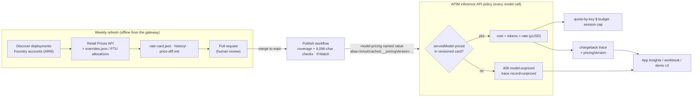

# Weekly model price-list lifecycle (phase 1)

Demo-grade, review-gated automation for **token models only**. No Azure resources are
deployed by the refresh workflow. Publishing updates just the existing APIM
`model-pricing` named value, not Bicep, products, budgets or the UI.

1. Discover every deployment in an explicit account allow list using Azure CLI/ARM.
   Capture account, deployment name, model, model version, SKU and account region.
   The optional image model is explicitly excluded; unrecognized token models fail.
2. Fetch all pages of the unauthenticated Azure Retail Prices API for those regions.
   Only USD consumption meters effective as of generation time are eligible.
3. Resolve reviewed, exact meter mappings from `overrides.json`; no fuzzy guessing.
   Explicit prices override retail mappings. Provisioned SKUs require an
   `allocations` rule and never use a retail per-token price.
4. Generate `rate-card.json` with effective date, content-derived version, source
   hashes and per-deployment evidence. Preserve old cards in `history/`; generate
   `price-diff.md` showing adds, removals, rate changes and source changes.
   Unchanged discovery/prices/evidence preserve the previous version and date.
5. Weekly (Monday 08:17 UTC) or manually, open/update
   `automation/sandbox-weekly-pricing` as a PR. A merge to `main` triggers the separate
   publisher, protected by an environment approval. Manual publication also uses
   the latest `main` card, never an unreviewed branch.
6. Publisher rediscovers deployments and rejects coverage drift, incompatible
   aliases, invalid prices/hashes, future-effective cards and oversized values.
   It preserves the old non-secret named value, uses the HTTP ETag with `If-Match`,
   updates through ARM, reads back the result and saves an audit receipt.



Legacy values with no `__pricingVersion` skip the guard and price exactly as before.

The committed initial card is deliberately **unpublished and empty**, not fabricated
deployment data. Configure the identities below and run the refresh workflow to
produce the first real card. Empty cards cannot be published. Fixtures are not live
quotes; they exist only for offline tests.

## Price rules and policy compatibility

All rates are **USD per 1M tokens**, using decimal arithmetic (retail `1K` rates
are multiplied by 1,000). Rules select deployment fields; more-specific rules win,
and tied rules or duplicate/ambiguous meters fail. The deployment's model/version/SKU
is bound to exact `productName`/`meterName` (or `meterId`) selectors by a reviewed
mapping. Region comes from discovery, not a global price assumption. Unsupported
units, currencies, tiers or missing cached/input/output meters do not become zero.
Use `"cachedInput": "same-as-input"` in a meter mapping only when explicitly
reviewing the absence of a cached discount.

The committed GPT-4.1 mappings use Azure OpenAI global meters. Other versions,
Standard/DataZone/Batch SKUs and new models need their own reviewed mappings or
explicit overrides. The DeepSeek rule intentionally preserves the lab's internal
illustrative price (0.58/1.68), with cached input explicitly equal to input; it is
**not a verified retail price**. Review it before commercial use.

Example internal PTU allocation rule in `overrides.json` (replace with your
documented amortization/allocation decision; these numbers are only illustrative):

```json
{
  "match": {
    "model": "gpt-4.1",
    "version": "2025-04-14",
    "sku": "ProvisionedManaged",
    "region": "swedencentral"
  },
  "usdPerMillion": { "input": "2", "cachedInput": "2", "output": "8" },
  "reason": "Internal allocation decision, not a retail PTU token quote"
}
```

Wire format:
`gpt-4.1=2/8/0.5;...;__pricingVersion=2026-10-12-<hash>`.
The first two fields remain input/output; old policies ignore the third cached
field and reserved version entry. Deploy the updated policy files through the
lab's **normal provisioning process once** before enabling publication:

- `policy.xml` snapshots the price list/version in inbound, and blocks an unknown
  POST model with a 409 and `x-gw-blocked-by: model-unpriced` **before backend spend**
  when the version marker exists. The trace includes `record=unpriced`, deployment,
  payer, request ID and pricing version. This guard is model-surface only; images,
  MCP, A2A, content safety and Responses GET/DELETE/stored reads are unaffected.
- `responses-pricing-fragment.xml` prefers the third-field cached rate, falling
  back to the existing `cached-input-pricing` named value for legacy two-field entries.
- `chargeback-fragment.xml` adds `pricingVersion`; legacy model records are
  `legacy-config`, unrelated surfaces are `not-model-pricing`.

No new zero-cost fallback is introduced. Without the version marker, legacy
policy behavior is unchanged, including its existing lack of an unknown-price
guard. Generation and live coverage validation prevent publishing an incomplete card.
Because the policy knows only a deployment name, **all accounts/regions/SKUs sharing
that name must have identical rates**, otherwise generation fails for human resolution.
The 4,096-character limit includes the version and cached fields; the automation
fails rather than truncating or silently splitting the named value.

## GitHub/Azure setup

Create two GitHub environments:

| Environment | OIDC identity and gate |
|---|---|
| `sandbox-pricing-discovery` | Read-only identity; restrict to `main` |
| `sandbox-pricing-publish` | Separate publisher identity; restrict to `main` and require reviewer approval |

In **each environment**, set secrets `AZURE_CLIENT_ID`, `AZURE_TENANT_ID`,
`AZURE_SUBSCRIPTION_ID`. Configure the identity's federated credential with
issuer `https://token.actions.githubusercontent.com`, audience
`api://AzureADTokenExchange`, and subject
`repo:<owner>/<repo>:environment:<environment-name>`.
No client secret or Azure token is stored in the repository.

Set `PRICING_ACCOUNT_IDS` (repository or environment variable) to a nonempty JSON
array of the **actual account ARM IDs** from the lab deployment, not the config's
`foundry1`/`foundry2` logical names. Both identities need the same allow list:

```json
["/subscriptions/<id>/resourceGroups/<lab-rg>/providers/Microsoft.CognitiveServices/accounts/<foundry-account>"]
```

Set `PRICING_APIM_ID` in the publish environment to the full APIM service ARM ID.
Use environment-scoped variables if the repository has more than one sandbox.

Least-privilege custom roles (management-plane Actions, no DataActions):

| Identity | Actions | Assignment scope |
|---|---|---|
| Discovery and publisher | `Microsoft.CognitiveServices/accounts/read`, `Microsoft.CognitiveServices/accounts/deployments/read` | Each allow-listed Cognitive Services account |
| Publisher only | `Microsoft.ApiManagement/service/namedValues/read`, `Microsoft.ApiManagement/service/namedValues/write`, `Microsoft.ApiManagement/service/namedValues/listValue/action` | Existing APIM `.../namedValues/model-pricing` resource |

Reader on each account is a simpler, broader alternative to the discovery custom
role. Avoid subscription-wide Contributor. The publisher refuses secret/Key Vault
named values; `listValue/action` is only used if ARM omits the value even though
`secret=false`, for baseline preservation/read-back. Scope that permission to
`model-pricing`, not all APIM secrets. Role-definition `AssignableScopes` can be the
resource group; role **assignments** should use the individual resources above.

Enable GitHub Actions' **Allow GitHub Actions to create and approve pull requests**
repository setting. Refresh uses `contents:write`, `pull-requests:write` and
`id-token:write`; publication needs only `contents:read` and `id-token:write`.
Protect `main` so rate cards are merged only after review; require the offline
check job. PRs made with `GITHUB_TOKEN` do not trigger further workflows: use an
optional `PRICING_PR_TOKEN` (GitHub App installation token supplied by your existing
token automation, or a fine-grained token with repository contents/PR write) when
required PR checks must start automatically. Without it, the refresh run itself
provides validation evidence, but required PR checks may need a human-triggered event.

OIDC never runs for PRs. PR validation uses fixtures only. Action dependencies are
pinned to commits. Publishing does not require permission to deploy or update
policies; policy provisioning remains a separate manual step.

## Local/offline use (PowerShell)

Run from the repository root. Python 3.12+ and the standard library are sufficient,
so no lab-specific dependencies or root manifest changes are needed:

```powershell
uv run --no-project python -m unittest discover -s labs\ai-gateway-sandbox\pricing\tests -v
pwsh -NoProfile -File labs\ai-gateway-sandbox\pricing\tests\test_policy.ps1
```

If uv cannot obtain Python because of TLS, use system
`python -m unittest discover -s labs\ai-gateway-sandbox\pricing\tests -v`.
`--no-project` avoids syncing the entire lab environment or creating a `.venv`.

Generate fixtures into a **scratch directory**, never over the live committed card:

```powershell
python labs\ai-gateway-sandbox\pricing\lifecycle.py generate `
  --deployments labs\ai-gateway-sandbox\pricing\tests\fixtures\deployments.json `
  --retail labs\ai-gateway-sandbox\pricing\tests\fixtures\retail.json `
  --effective-from 2026-10-12T00:00:00Z --directory "$env:TEMP\pricing-offline"
python labs\ai-gateway-sandbox\pricing\lifecycle.py check --directory "$env:TEMP\pricing-offline"
```

After `az login`, put actual account IDs in ignored `pricing/accounts.local.json`:

```powershell
python labs\ai-gateway-sandbox\pricing\lifecycle.py generate `
  --accounts labs\ai-gateway-sandbox\pricing\accounts.local.json
# Review and merge the rate-card/diff/history changes before publishing.
python labs\ai-gateway-sandbox\pricing\lifecycle.py publish `
  --accounts labs\ai-gateway-sandbox\pricing\accounts.local.json `
  --apim-id "/subscriptions/<id>/resourceGroups/<rg>/providers/Microsoft.ApiManagement/service/<name>"
```

Publish is a dry run unless `--apply` is supplied. `--apply` requires live discovery
and cannot use `--deployments` fixtures. Prefer the main-only, approval-gated workflow.
The baseline/receipt are ignored locally and uploaded for 30 days by the workflow.
An ETag conflict or failed read-back fails the job; a write may already have succeeded
on read-back failure, so inspect Azure and the baseline before retrying. Gateway
propagation is not instantaneous; read-back verifies ARM, not a billable inference call.
To roll back, restore a reviewed historic card through a PR and publish it after live
coverage validation (old cards with different deployments will correctly fail).

## Deliberate limits / phase 2

- Streaming `text/event-stream` responses still bypass outbound JSON pricing.
  Fixing SSE usage metering is a separate task, not part of this automation.
- MCP tools, agents, images and content safety retain their flat internal prices.
- `sandbox-config.json` still seeds prices during normal provisioning. Redeploying
  the lab can overwrite `model-pricing`; manually republish the approved card afterward.
  UI labels still reflect config prices, not the independently published rate card.
- This is a weekly review loop, not production reconciliation or real-time deployment
  admission control. Account allow-list completeness is an operator responsibility.
- **Phase 2 only:** reconcile version-stamped gateway chargeback with Azure Cost
  Management actuals, negotiated discounts and PTU utilization/allocation. No Cost
  Management queries, exports, reconciliation or true-ups are implemented here.
